<!--
  This journal is auto generated by Stasis.
-->

# 11/04/2026 - Routing the Keybit Flex

So today I finished routing the whole new keybit. Its a cross shaped flex with the CH592F in the middle and a flap on each side that folds up into the case, and each flap has 6 magnet pads going N S N S N S plus its own little switch circuit. I routed the north flap first, then copied it to the other 3 sides and relinked the copies to their own parts in the schematic (south, east and west) so every side has its own nets.

The tricky part is the magnet voltage. Since you can put a key next to another one in any rotation or stagger, you dont know which magnet net (A or B) is going to be + and which is GND. So each side has 2 P-FETs (RV2C014BCT2CL) that connect a net to VBUS and 2 N-FETs (SSM3K56ACT) that connect a net to GND, with the gates crossed. Whichever net is higher turns on the P-FET to VBUS on its side and the N-FET to GND on the other side, so it acts like a bridge rectifier but without losing 0.6V per key like diodes would. Then 2 more small N-FETs on an EN pin let the CH592 decide if a side is allowed to send power out, while a dead key can still get power in through the body diodes. The 1M resistors keep the magnets at 0V when nothing touches them, and two RB520 diodes into a 100k/300k divider let each side sense if its getting power, which is how the keyword can figure out who is next to who.

All the transistors are DFN1006 (1x0.6mm) which is tiny but its the only way all of this fits on a ~5mm flap. Here's a closer look at the south flap and the middle with the CH592, the crystal and the antenna in the corner with a keepout around it

I also had to move a bunch of traces away from the folds since anything running along a bend will crack, and I switched the board to JLC's flex rules (1/3 oz copper, 0.025mm polyimide) so DRC checks against what they can actually make.

# 11/03/2026 12:00 PM - More features to add

KH-1608-H08 chip antenna

https://www.jc-magnetics.com/Magnet-N52-1mmx2mm-discs-cylinders

actually ons econd thought ill just order a ton of these ^^ and conductive epoxy them to the contacts adn yea.

I was also looking at hall effect sensors for keys that support taht and was looking at HAL9303RSO (C42387471) as this is what is used but I was thinking about TMAG3001 but its more expensive.

I am also thinking RGB lighting so I need quite a bit of LED's to run this adn especially off of battery so I'm thinking of having modules taht function as batteries adn can be recharged if there is USB there and yea. 

I also want the keys to be hot swappable so I need some connectors taht support this that are on LCSC so I chose Mill-Max Mfg. Corp. 3305-0-15-15-47-27-10-0

C17317022

Then I started laying out the new keybit flex. Each of the 4 flaps has 6 magnet pads going N S N S N S (MAG_NA / MAG_NB) and a row of tiny DFN1006 mosfets under them that let a neighbour connect either way round, plus the debug pads (GND, TIO, TCK, 3V3) and the hot swap sockets on the middle part. I also switched the board to JLC's flex rules (2 layer, 1/3 oz copper, 0.025mm polyimide) so DRC actually checks against what they can make.

Heres how each side works. Every side has two nets, A (the 3 N magnets) and B (the 3 S magnets), and since a neighbour can touch you either way round (rotated or staggered), either one could end up being + or GND. So each side has 2 P-FETs (P1/P2, RV2C014BCT2CL) that connect a net to VBUS and 2 N-FETs (N1/N2, SSM3K56ACT) that connect a net to GND, with their gates crossed over. If A is higher, N2 sees A on its gate and pulls B to GND, and P1's gate gets pulled down to B so A connects to VBUS. If B is higher its the mirror image, so it basically acts like a bridge rectifier but without losing 0.6V per key like diodes would.

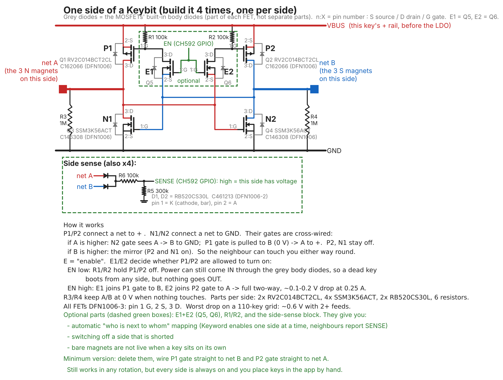

On top of that theres E1/E2, two more small N-FETs on an EN pin from the CH592. When EN is low the 100k pull ups keep P1/P2 off, so power can still come in through the body diodes (a dead key can still boot from any side) but nothing goes out. When EN is high the side fully turns on both ways. The 1M resistors keep A and B at 0V when nothing is touching. Then theres a sense part per side, two RB520CS30L diodes from A and B into a 100k/300k divider going to a GPIO, so the key can tell which of its sides have power and the keyword can figure out which keys are next to each other by turning one side on at a time. Everything is DFN1006 (1x0.6mm) so it fits on the flaps, and I simulated it and the worst key on a 110 key board only drops about 0.6V as long as theres 2+ battery boards or USB feeding it.

Still need to move the parts and the trace along the fold away from the bend and round off the corners where the flap meets the middle so it doesnt tear.

# 11/01/2026 11:00 PM - Thoughts on the first revision and prep for V2

_Time spent: 1h_

Okay so this is fine and all but taking a look at the state of the project, I think that I shouldn't waste too much time fleshing out this first version anymore as I know how to improve it and have tested everything there is to test (well maybe except battery charging but I'll do that rn). I want to make this significantly cheaper so that others can actually use this, one of those ways would be to use CH592D and make a 1u controller board instead of a 2 stacked 1u boards as that caused a lot of inneficiencies with the case and also the corners are kind of cooked (this also means I can have a bigger battery on the top) and following the designs for the ones on the bottom, this should all fit inside a caserather nicely. I also plan on making versions that have rotary encoders, oleds, and yea. Some other stuff that I found would be to make everything from a flex pcb as this would make things significantly easier to put together in a case.. I am also thinking about steering away from pogo pins and just using magnets with conductive epoxy for the connections as this would save a TON of money and yea. I think that this is feasable and i was looking at displays and found this https://www.buydisplay.com/square-white-0-96-inch-96x96-oled-display-screen-ssd1317. I'll start cadding a new version tmrw but oh well this is good for a V1. 

https://www.amazon.com/HARFINGTON-Stainless-Cylindrical-Furniture-Installation/dp/B0F6D1P67B

# 11/1/2026 1 PM - Tough 2000 Cases (Final V1 Journal)

_Time spent: 5h_

So the cases I had printed before were pretty brittle, so I reprinted all of them out of Tough 2000 resin on the Form 4 and they came out way better. Heres the keyword with 5 keybits around it in the new cases

The third keybit in a chain also wasnt getting detected, but it turned out to be just one bad joint where a pogo pin wasnt touching, after swapping keybits around I had 4 keybits (3 deep) working for a full minute so the firmware is fine.

I also made macros go up to 64 steps instead of 16 (the keymap now only saves as much of each key as it needs so it still fits in flash) and gave the app a new icon.

Then I looked at batteries again. The keyword by itself would be fine on a tiny cell, but each keybit pulls like 3-5mA because it never sleeps, so after 6-8 keybits it would be too much. So next up is making the keybits sleep until a key gets pressed.

# 10/29/2026 4 PM - USB Keyboard and Faster Side Bus

_Time spent: 5h_

So the chained keybits were showing up in the app but not in the right spot, so now each keybit says which side of which keybit its on and which way its facing (v11) and the app puts them exactly where they are. I also made a little sim that runs the real keybit and keyword bus code on my mac with a bunch of keybits at once so I could test without plugging stuff in over and over. With that I got the side bus back up to 100kHz with keybit v12 and v13, and each event now has a number and a CRC so presses dont get lost or doubled.

Then I made the keyword show up as a USB keyboard too, so it types from the saved keymap even without the app open, and fixed saving the keymap while bluetooth is connected. And now it actually types!!

# 10/28/2026 11 PM - Flashing Keybits and Chaining Them

_Time spent: 6h_

So I still couldnt get the keyword to flash the keybits so I got some CH32V003 dev boards off amazon to see if my chips were fried. Turns out it was my SWIO driver, the timing was off because the delays werent getting inlined so a 1 looked almost like a 0. After that the halt was breaking the link and most of the writes were getting dropped, so I gave writes their own timing and made it verify and resume instead of starting over, and then it finally flashed the keybit firmware!! It also works without the 1k pull up now and blinks blue while flashing and green when its done.

A big bag of switches also came in so I can build more keybits

Then the sides werent detecting anything, the keybits couldnt keep up with 100kHz I2C so I dropped it to 20kHz. After that it was a bunch of bugs with keys connecting and disconnecting over and over (the keybit jamming the bus, timeouts too short, the dock blocking the sides while flashing) and I went through keybit firmware v7 to v10 fixing them

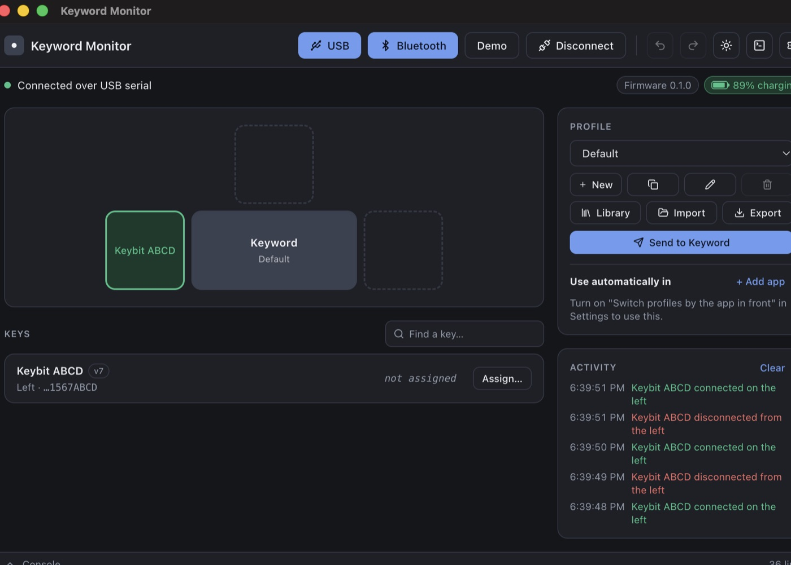

Also when I put a board on the wrong way the whole keyword turns off, so for the next revision I want to protect the 3.3V on the dock and sides and add some resistors on the data lines. It also detects when a keybit is backwards next to another one now

and by the end I had 3 keybits chained off the keyword and all of them showing up in the app!!

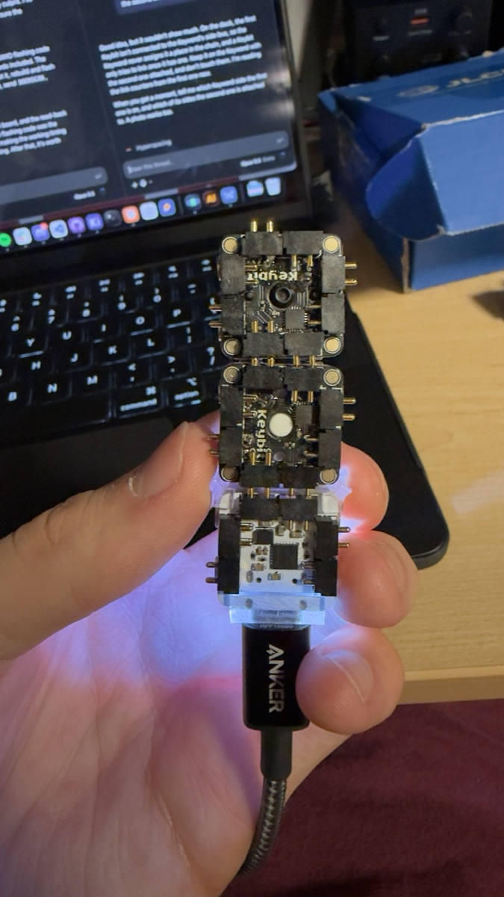

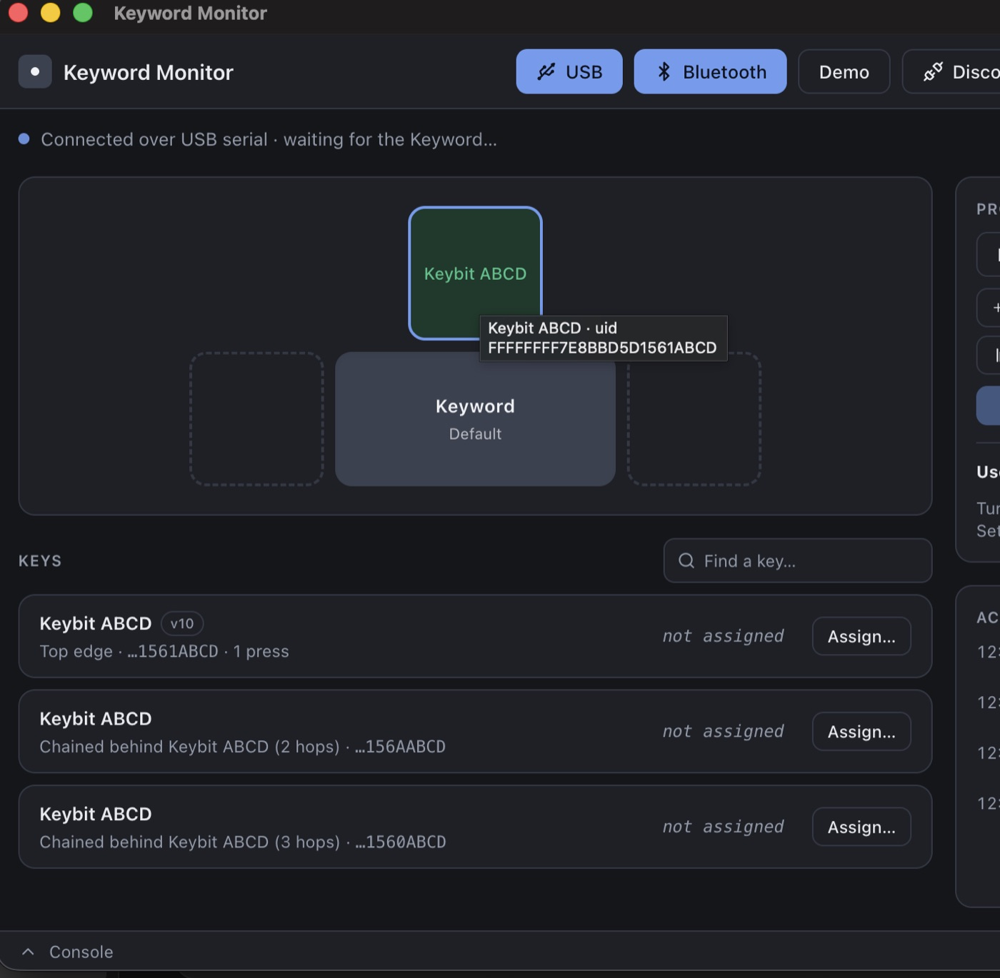

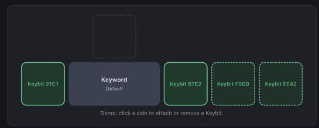

# 10/27/2026 10 PM - Ideas for the Next Keybit

_Time spent: 4h_

So the current keybit only works in a straight grid and the pogo headers are like half the cost, so I spent today thinking about how to make the next one better. First idea was sending power and data over just 2 wires, kinda like the AC coupling from my 6.2020 lab where the data goes through a cap onto the DC line

Then for staggered keys, if the contacts are spaced 2.38mm apart (19.05 / 8) a key can slide along another one and snap every 25%, and if every contact is a magnet on a pogo pin going N S N S around the sides it also works when you rotate it. Here are my sketches of it

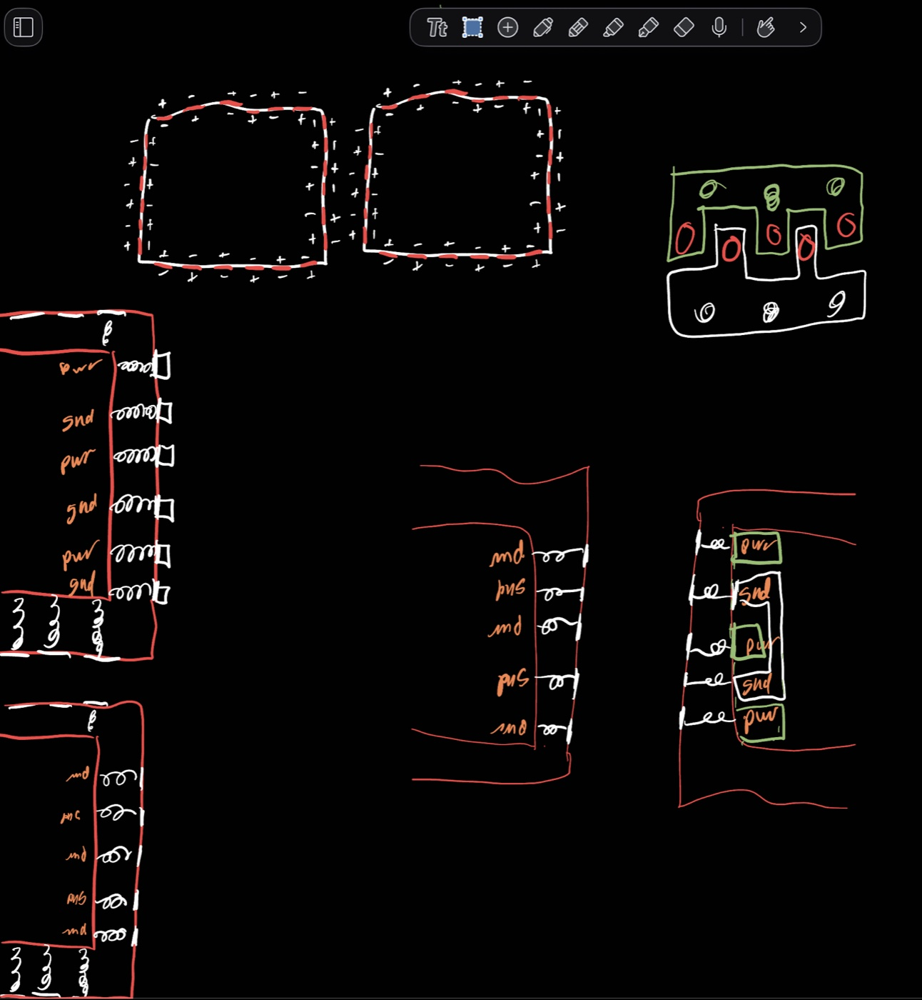

I was looking at these 1mm x 2mm magnets for it, but theyre a lot weaker than the J7 ones so I would probably need a second row just for holding

The other idea is making the keybit a flex pcb with 4 flaps for the pogo pins that fold up into a box inside the case, which gets rid of the expensive right angle headers. I priced it out on JLC and its about $1.49 a board.

I also rewrote the desktop app in typescript with react and tailwind and cleaned up the firmware folder

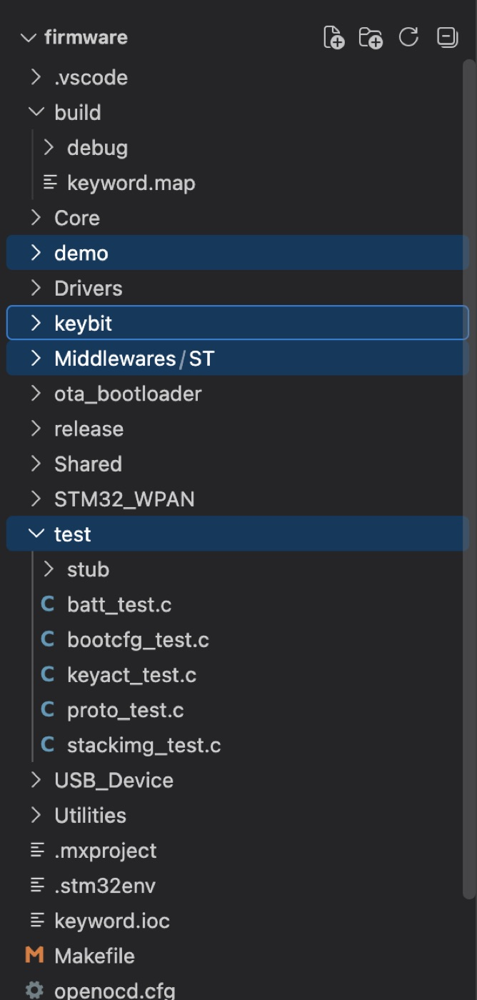

# 10/26/2026 6 PM - Keyword Flashed and Bluetooth

_Time spent: 5h_

So it turns out my STLINK V3 was the problem the whole time (it didnt work on Ember either), I used an old STLINK V2 and it connected right away lol

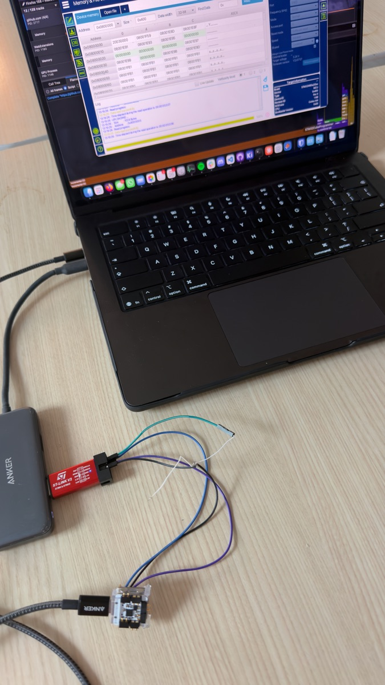

I installed the bluetooth stack and the bootloader and it showed up as "Keyword" in bluetooth with the green LED!! Then I got updating it over bluetooth from the app working and flashed the second keyword too. The battery also says 87% with no battery plugged in lol

The keyword still couldnt see a keybit on the dock though, and I also added some protection in the firmware for when a keybit is put on rotated since that can jam the bus and stress the chips.

# 10/25/2026 11 PM - SWIO, Bluetooth and Not Being Able to Flash

_Time spent: 6h_

Now that it worked I wanted the keyword to be able to flash the keybits by itself. The 3 studs on top of the keyword line up with the pads on the bottom of a keybit, so I wrote a driver that bit bangs the CH32's one wire debug protocol (SWIO) and the keyword can flash any keybit put on top. I also wrote the keybit firmware, made the keyword hand out addresses using each chip's unique ID, and added bluetooth and a desktop app to remap keys.

Then I spent most of the night trying to flash the keyword and it would not connect. I tried the wrong header on the STLINK, soldering wires on, swapping the data wires, soldering reset, an Atmel-ICE, and I even messed up the boot settings over USB DFU aaaa

# 10/24/2026 9 PM - It Finally Works!!

_Time spent: 4h_

So the press fit coupon came out and none of the 7 pockets were actually press fit, the magnets just dropped into all of them so the form 4 prints them a bit oversize and I'm sticking with glue. In the end I went with the normal J7 for the keybit (8 4mm x 3mm magnets sticking out 0.75mm) and the J7.1b for the keyword which uses 2 of the 4mm x 1mm magnets on collars on every side, since that one actually worked.

Then I cleaned up onshape, moved everything back into the original keybit, keyword and keybytes docs, trashed the old 4x2 magnet docs and updated the main assembly with the 1.5mm gap between cases. All the joint tests are in [`cad/tests`](cad/tests) and the final cases are in [`production/CAD`](production/CAD), all as STEP files now.

I also changed the keyword to white solder mask with black silkscreen on both sides in kicad.

And then I put it all together and it finally works!!! Here is a picture of it

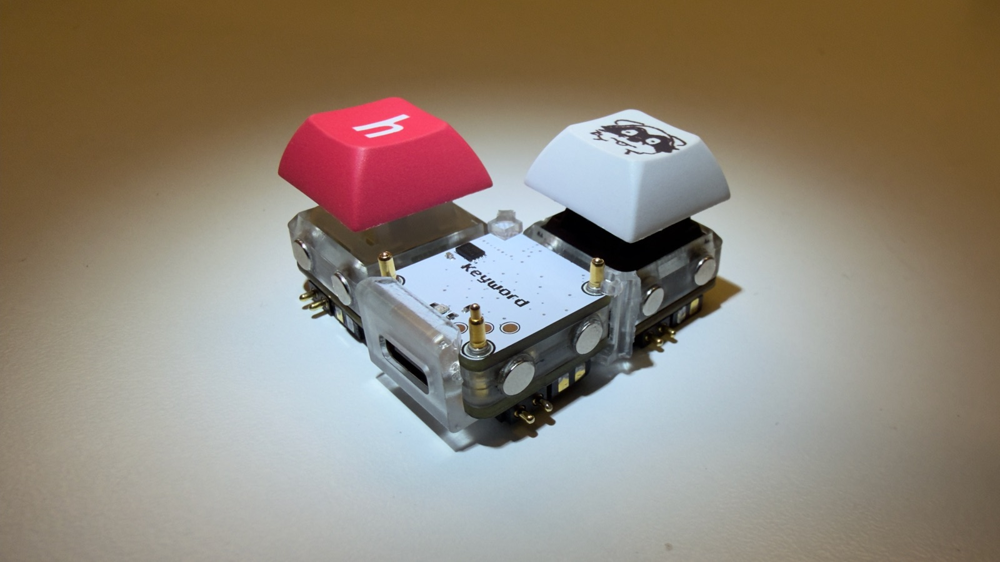

and here is the demo

Later that night I also posted it on r/MechanicalKeyboards

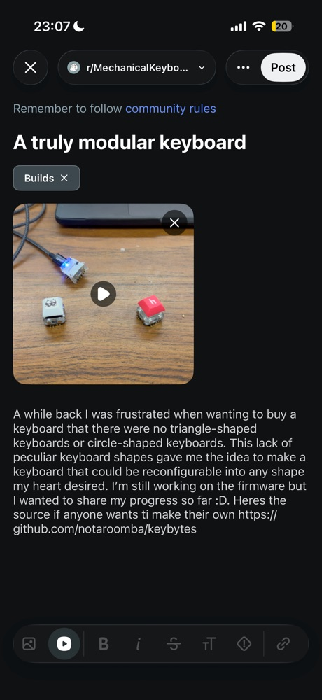

# 10/23/2026 10 PM - Gluing Magnets and Picking a Joint

_Time spent: 5h_

So I started gluing the magnets in with gorilla super glue gel (from the inside so it doesnt get on the faces) and when I put two J7 keybits together they tilted up a little. I thought I had to sand it but it turned out that glue had gotten onto the outside face of some magnets so they werent flat, after scraping it off with a razor the tilt went away. Btw acetone doesnt hurt the magnets but it does wreck the resin so dont get it on the case.

J7 was the one I liked the most so I made it the main keybit case.

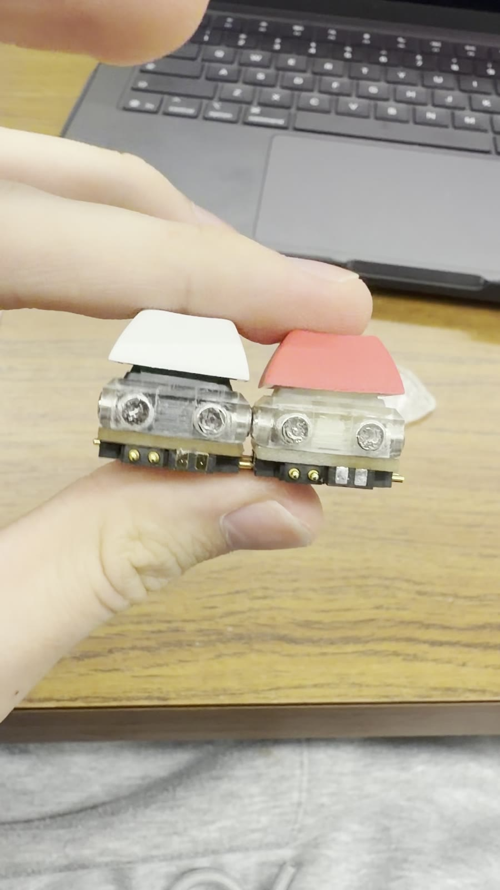

The magnets kept deflecting when I pushed them in against the keyswitch so I also designed a jig that drops in where the switch goes so they all stop at exactly 0.75mm.

For the keyword the plain pocket J7 tray was too tight for the 4x2 magnets (probably resin curing tolerance) but the collar one worked. I also realized that I need at least 2 magnets per side on the keyword like on the keybit, and since the collars stick out, a 4x1 magnet never reaches into the tray so it doesnt hit the side contacts or the inductors anymore. That made the J7.1 and J7.1b keyword trays and also a press fit coupon to see if I could skip the glue completely.

I also priced out a full sized keyboard (2 keywords and like 110 keybits) and its around $900 assembled, almost half of that being the pogo pins lol, so if I ever make a full one ill buy them seperately and solder them myself.

# 10/21/2026 10 PM - Pogo Pin Force

_Time spent: 3h_

So after the first magnet cases I noticed the magnets werent strong enough to hold the modules together against the pogo pins. I also tried putting the magnets into the pockets and sometimes they just wouldnt stick and would fall out.

I spent some time looking on digikey for single right angle pogo pins with a low enough spring force that a 4mm x 1mm N52 magnet could hold it. The closest thing was the Mill-Max 0967 horizontal SMT pins with the low force springs, but they need a different footprint so I would have to redo the boards, so I decided to make the magnets stronger instead.

# 10/20/2026 9 PM - Tinkering With Designs and LED Blink

_Time spent: 8h_

So I have been tinkering with the designs and stuff the past 2 days, mostly the keyword case in onshape. I made a bigger version of the case with holes for the magnets and split it up into an inner part and left and right 
side pieces. 

**This was the result of many iterations that I had to spend resin printing, curing, sanding / polishing, and then tinkering with the design and making tons of modifications** 

this is v12 of the case and its the most overengineered thing ive done, I also got n55 magnets from some sketchy seller so hopefully they hold

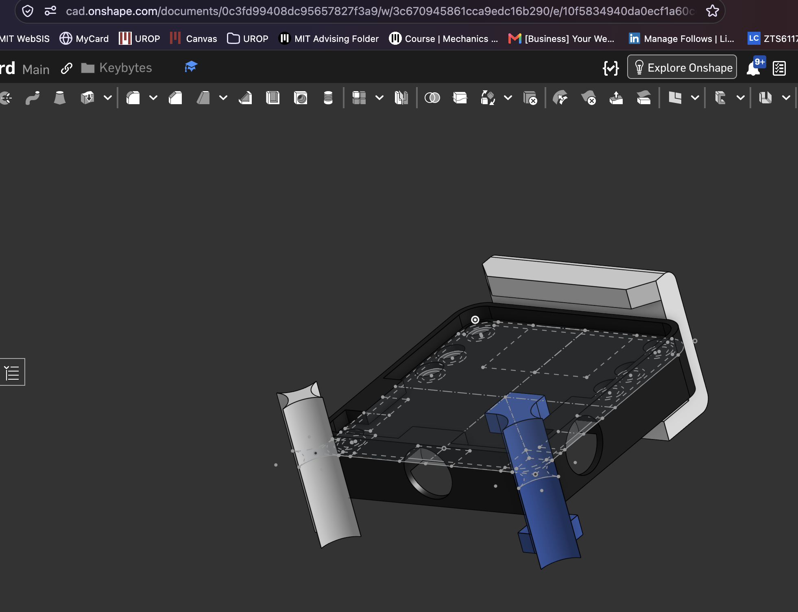

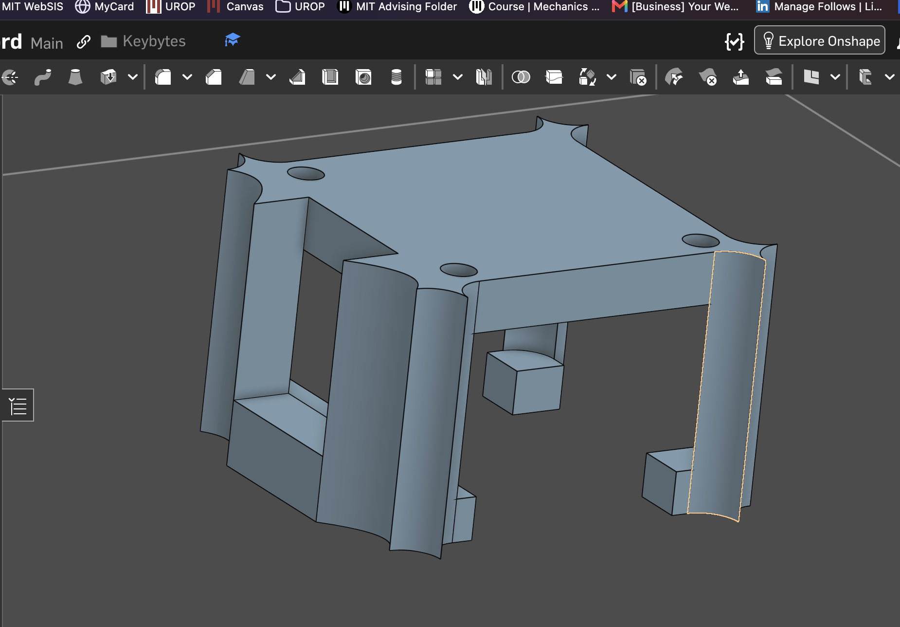

then I put the pcb in to check that the pogo pins and usb line up with everything and yea

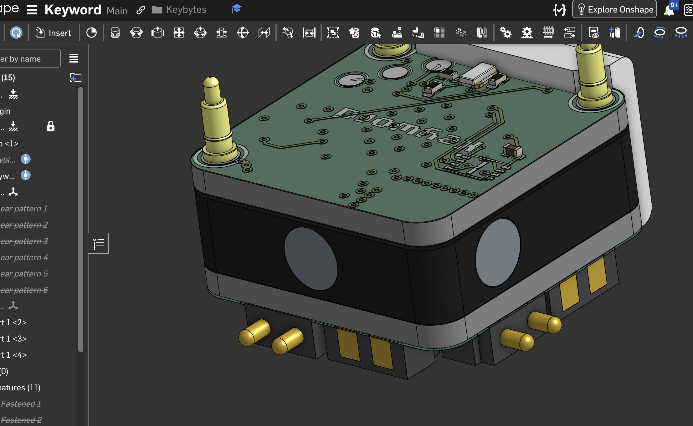

I also did a section view of the whole thing to check nothing was hitting inside, its currently printing so hopefully it works

I also got the first firmware on the keyword, its just a blink that cycles the RGB status LED through red, yellow, green, cyan, blue, magenta, white and off every 500ms. The only downside is that i gotta use the swd to flash it bc i changed the boot options aaaaaa

# 10/16-18/2026 5 PM - Resin Printing and Flashing

_Time spent: 14h_

So the boards came! and I learned how to resin print at the makerspace, you print it on the formlabs printer, then wash it in the 2 IPA washes, let it dry and then cure it

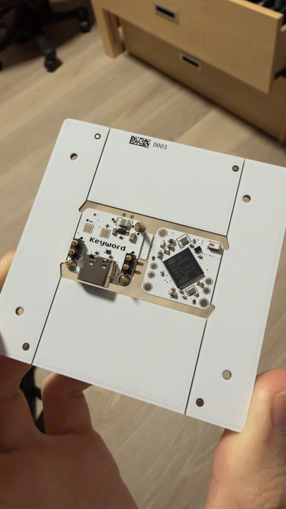

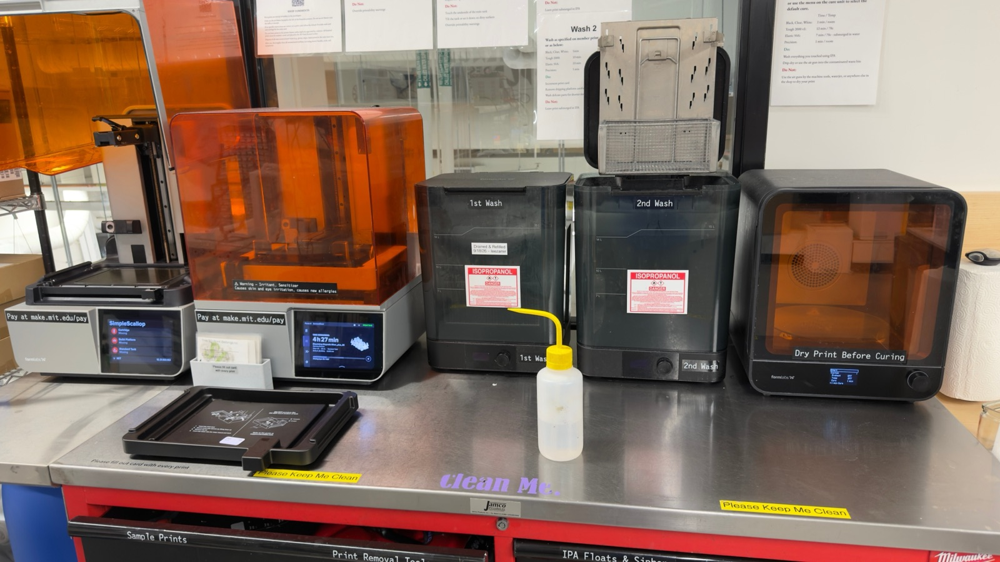

and I got a bunch of clear prints out of it, v1 had some problems so I still gotta clean up the resin print stuff

I also got it to flash! It connects to STM32CubeProgrammer over USB DFU even with the usb c going through the pogo pins and yea

# 10/2/2026 1 PM - Fixing Board Errors

_Time spent: 5h_

So before ordering I went through both boards again and ran DRC and ERC on everything and found a bunch of stuff that would have been bad

the biggest one was on the keybit, one of the pogo header GND pads wasnt connected to anything, the via was there but the track to it never got drawn so that side would have had no ground. Also the SDA3 trace was basically touching the 3.3V pad on one of the pullups (0.02mm lol) so i moved the resistor and rerouted that and yea

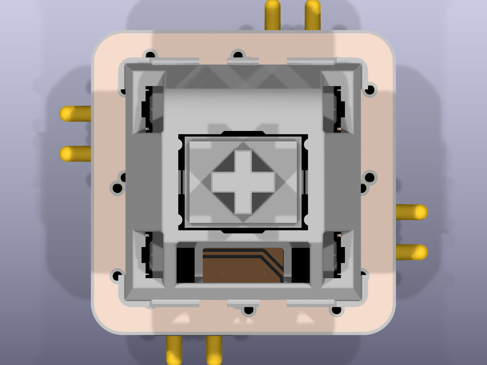

on the keyword a bunch of the resistors all had the same lcsc number which was a 150 ohm resistor with 0 stock so jlc would have put the wrong values on the charger so i cleared those, and the pads that the pogo pins land on were in the bom as pogo pins so I set them to dnp

I also fixed all the library and 3d model paths since they were hardcoded to my windows pc and didnt work on the mac, now they are relative to the project. Then I added the jlcpcb order and shipping to the bom

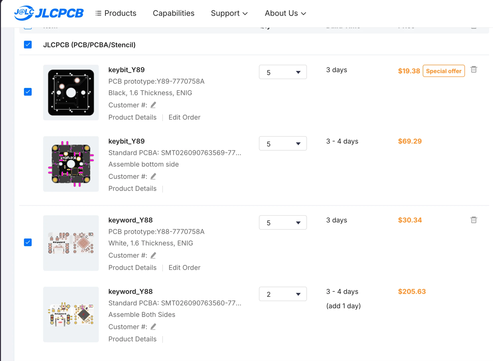

# 6/18/2026 8 PM - Finish CAD

_Time spent: 8h_

So i did a thing with clay and finished the case andx yea, this took a long time as I had a few revisions and yea ts is finished, i will blender render soon as im macondoing and just wanna shoip this so it arrives druring fallout

# 4/10/2026 3 AM - More Cad and finished Keybit Case

_Time spent: 7h_

So after messing around with a few designs in onshape, I got a better Keycap design

there are internal holes for the magnets and the thing latches on to the key switches side latches as shown here

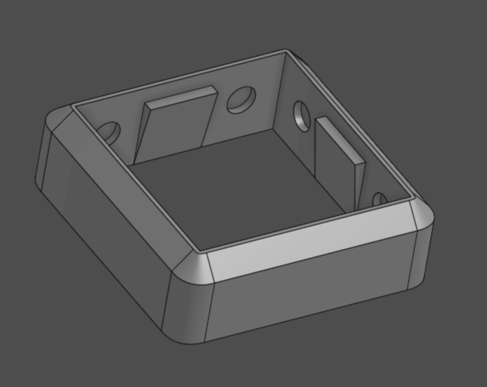

i then printed it out and did a thing and got this

and yea thats basically it, Ill plan on continuing the cad for the main pcb and make it cleaner

# 4/8/2026 12 AM - CAD + Case

_Time spent: 7h_

Idk how to cad but I tried to do it and ended with soemthing like this:

which got printed and it kinda works but the corners are too small and yea

I printed a few out and showed them to clay and he liked them and yea, altho its thin I plan on making the walls thicker and yea, aside from that I think its pretty much done

# 4/6/2026 3 AM - Flash and LED and Touchups

_Time spent: 7h_

So I kinda want to be able to program the CH300v chips from the main board so I needed to add in some pogo pins and then I would also need flash to store the code so I added that in and updated the STM32 MX for that

Then after that I finished routing up everything and also replaced the old LED with a RGB one.

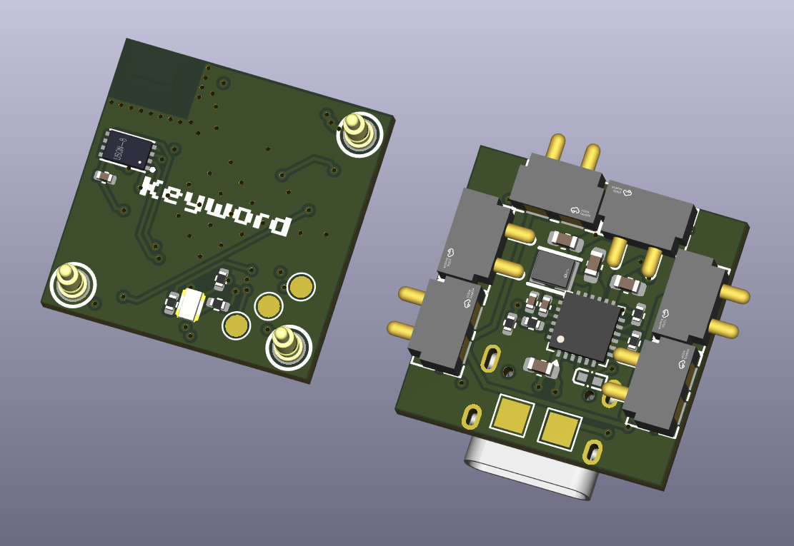

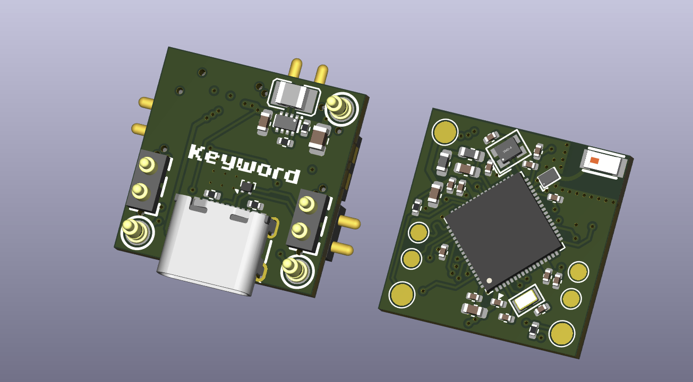

Then I updated the schematics to look better and yea

# 4/5/2026 7 PM - Routing

_Time spent: 7h_

So I locked in for a day and finished up the routing for both PCB's. I also had to add in some I2C pullup resistors and had fun with laying them out on both sides and yea

I also did the same for the keybit and ended up with this

it took me a while as I forgot that I had to add in pullup resistors and then had to move things around to add space for them

# 4/5/2026 12 AM - Keyword and Routing

_Time spent: 7h_

So I had a bunch of back and forth between the 2 different STM32 chips, I oringlaly planned on having eherythign on one boar dbut with bluetooht then that would be way complicated so I decided to go on St's website to try and find any stm32s that would support bluetooth and I found a small one bue that meant using a usb to hid converter but the smallest one I could find would take up half the board so I decided to split the boards, and in doing so I rediecided that if I was going to have more area, I might as well have a bigger stm32 chip and just add more stuff to it so I did that and ended up with this:

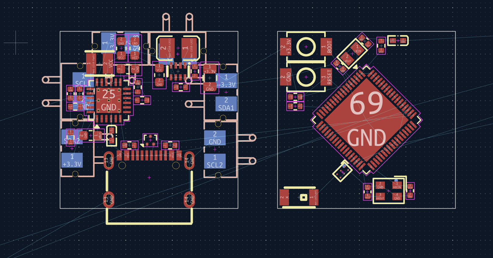

I was still placing the components so I decided to do that some more and got this

# 3/27/2026 2 AM - Ideation and Schematic

_Time spent: 9h_

So basically Ihad always wanted to make a keyboard but I didnt want to be locked into just one design so I wanna make it so that I can rearrange it at any time.

Yea...

I searched online and couldnt find it anywhere so I decided to make it myself.

I decided on using a cheap risc-v processor and i2c to communicate between the keys and then have a central MCU block that has bluetooth and battery support so yea.

I started on the keybit design (ha ha) and got this:

I then also started on the other design for the keyword

