<!--
  This journal is auto generated by Stasis.
-->

# 10/28/2026 11 PM - Flashing Keybits and Chaining Them

_Time spent: 6h_

So I still couldnt get the keyword to flash the keybits over SWIO, and I wasnt sure if the chips on my keybits were fried or if the driver was wrong, so I got some CH32V003 dev boards off amazon to test with. Turns out it was the driver. The firmware builds with -Og so the delay functions never got inlined and every pulse came out about 15 cycles too long, which made a 1 look almost like a 0. After fixing that I shorted the SWIO stud to ground to make sure the keyword could actually see the line and then it finally started detecting the chip (blue then red lol).

After that it was a long list of problems:

- the halt command was resending the link setup commands which cut the link every time
- reads were fine but only like 1 in 4 writes actually landed, so writes needed their own short pulse timing
- around 1 in 100 messages still got garbled (probably from me holding the board by hand) so I made it verify every write, retry, and resume from the last good block instead of starting over

and then it flashed the whole 6.4KB keybit firmware and read it back as a match!! I also got it working without the 1k pull up on SWIO by driving the line push pull and reading the answer a bit later. Now it blinks blue while flashing, green once when its done or already up to date, and red only when it gives up.

A big bag of switches also came in today so I can actually build more keybits

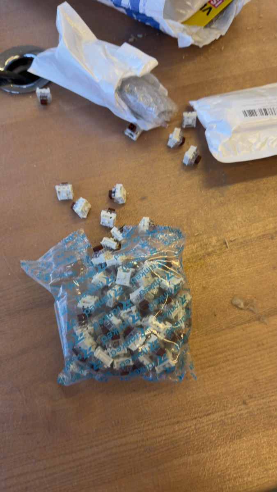

Then the sides werent detecting anything. The keyword talks to the sides with hardware I2C at 100kHz but the keybits bit bang their I2C while also watching their other 3 sides so they couldnt keep up, dropping it to 20kHz fixed that and I got the white blinks for a keybit joining. A second later the bus would lock up though, because a keybit that hadnt been addressed in 2 seconds would pull the clock low to check if that side was another keybit, which jammed the keyword's bus (fixed in v7). After that:

- the I2C timeouts were 10ms but reading a chained keybit at 20kHz takes about 19ms
- the dock was blocking side polling for seconds while it flashed so keys kept connecting and disconnecting, now it flashes 2 blocks at a time
- the watchdog was firing during long flashes and resetting the keyword
- keybits were locking a side as the keyword's side forever (v8), giving up link requests too early (v9), and the probe timing could get stuck when the SysTick timer rolled over (v10)

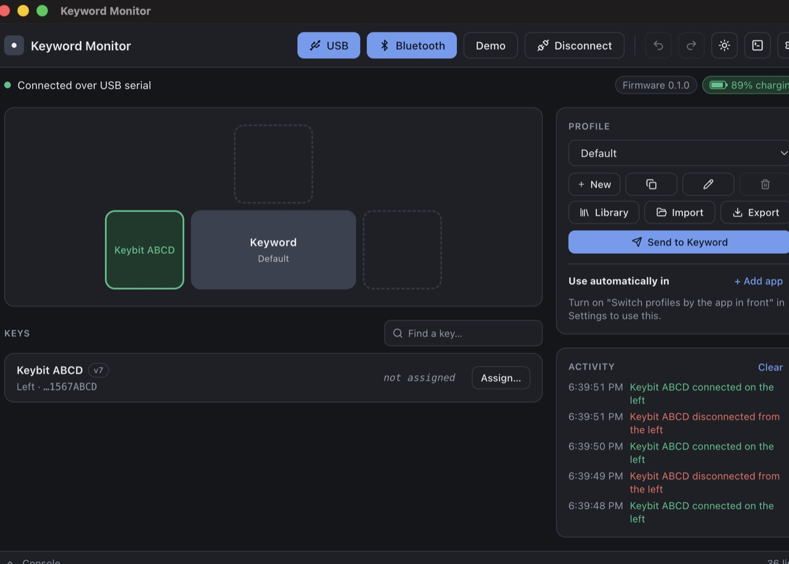

Another problem is that sometimes when I put a board on the wrong way the whole keyword turns off and drops off USB. Docking it backwards shorts or drags down the 3.3V, and I even got a brownout reset with a board on the right way. So for the next revision I want a current limited load switch on the dock and side 3.3V, ~100 ohm series resistors on SWIO and the I2C lines, and some way to key the dock so a board only goes on one way. Also since all 3 sides share 1 bus the keyword cant tell a rotated keybit on the top from one on the left, so a sense line per side would fix that.

It also detects when a keybit is next to another one backwards now and blinks red twice

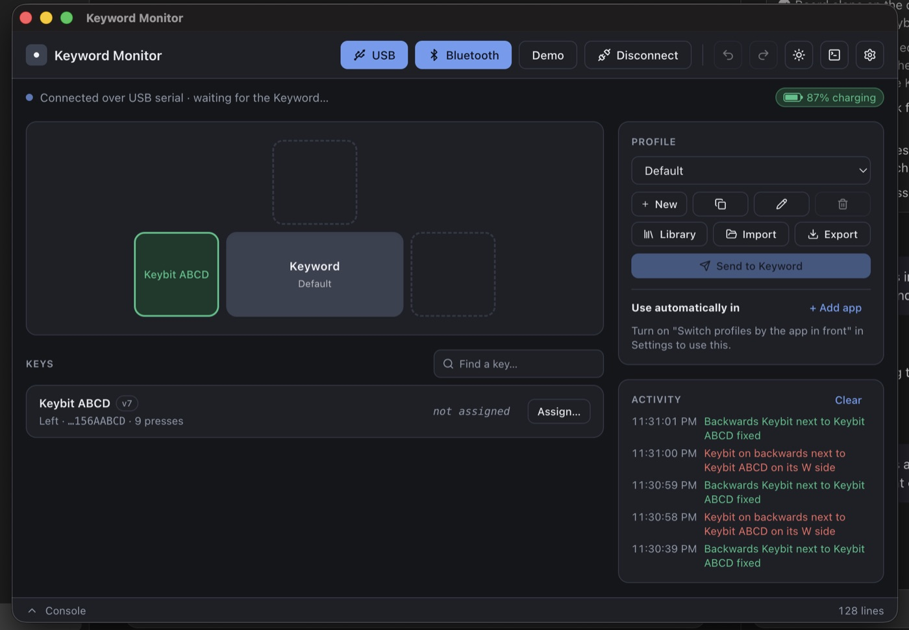

But by the end I had 3 keybits chained off the keyword in a row and all of them showing up in the app!!

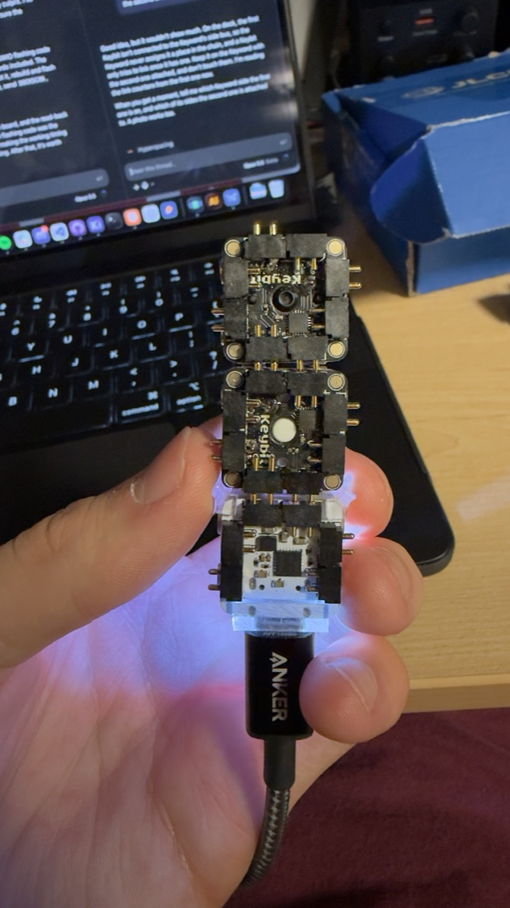

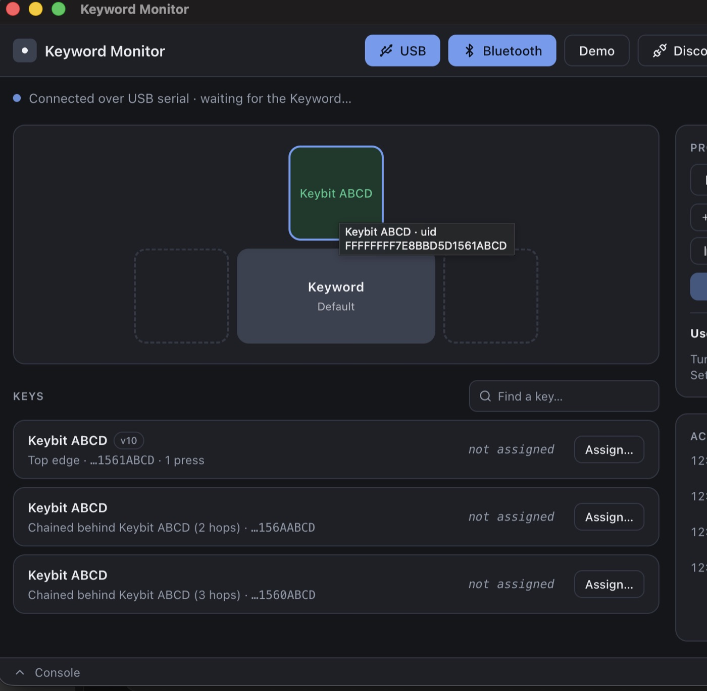

I also made the app draw the chained keybits on the board view so you can see where each one is

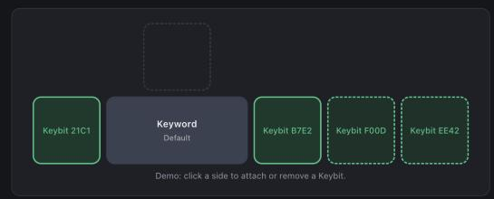

# 10/27/2026 10 PM - Ideas for the Next Keybit

_Time spent: 4h_

So the current keybit only works in a straight grid and the pogo headers are like half the cost, so I spent today thinking about how to make the next version better.

The first idea was a 2 wire system where power and data both go through 2 terminals so keys can be staggered. I got the idea from my 6.2020 lab where you AC couple a signal through a cap, so the data would go through a cap onto the DC power line and then a bridge rectifier at the other end gets the power back.

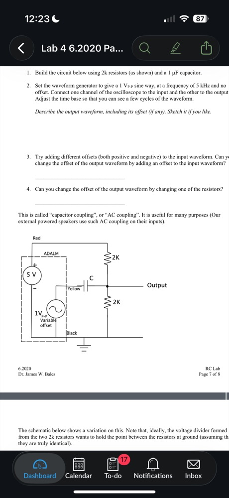

It turns out its doable but it needs a MOSFET bridge instead of diodes (a 0.6V drop at every key would kill the power a few keys out), a small choke so the bulk cap doesnt short out the data, and the data has to be sent as a 2MHz carrier.

Then for the stagger, if the contacts are on a 2.38mm grid (19.05 / 8) a key can slide along another one and snap every 25%, which covers every normal ANSI/ISO stagger since those are all multiples of a quarter key (37.5% isnt really a thing). If every contact is a magnet on a pogo pin with the poles going N S N S clockwise on every side, then at every quarter step N lands on S and pulls, halfway between N lands on N and pushes it to the next step, and it still works when you rotate a key 90 degrees. Here are my sketches of the alternating magnets around the edges, the pogo pins with springs on each side, and how the contacts line up when two keys slide past each other

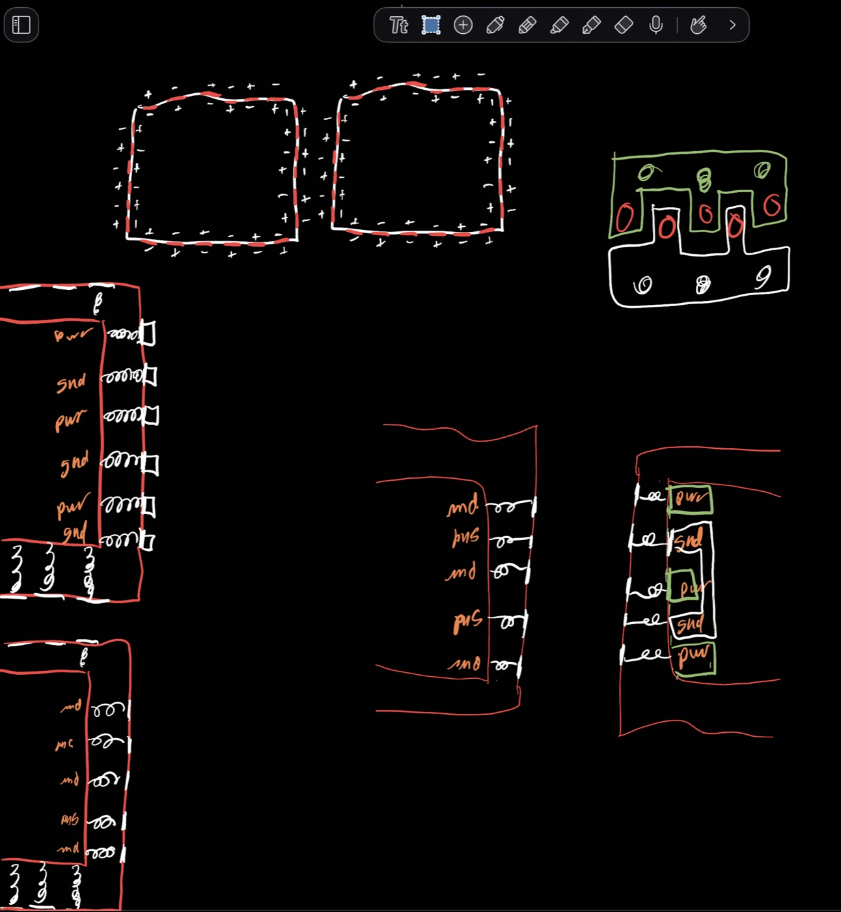

I was looking at these 1mm x 2mm magnets from JC magnetics for it

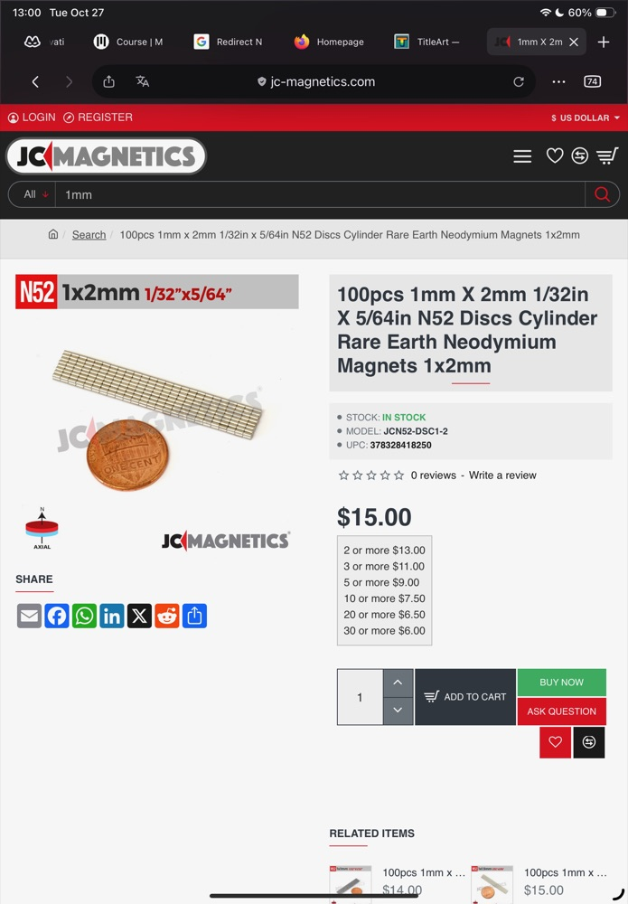

The small magnets are about 3-5x weaker than the J7 ones though, so I would add a second row of bigger block magnets just for holding, and maybe a tongue and groove lip so a row doesnt fold when you pick it up.

The other idea is making the keybit a flex pcb with 4 flaps that have pads for the pogo pins. I solder the pogos on, fold the flaps up into a box and slide it into the case, and the case holds the switch. That gets rid of the right angle pogo headers which are the most expensive part. I priced out 5 panels of 5x5 flex boards with the CH32 assembled on JLC and it came out to about $1.49 a board. I also looked at hot swap sockets but the Kailh one is about 0.8mm too wide to fit, so it would have to be the Mill-Max cups.

I also noticed that if a keybit is plugged into another keybit backwards nothing tells you, so now the keybit firmware (v6) flags a side thats held low as backwards and the keyword sends that to the app.

And I rewrote the desktop app in typescript with react and tailwind and installed it as an app on my mac, and cleaned up the firmware folder so the keyword's CubeMX project is in its own folder next to the keybit one.

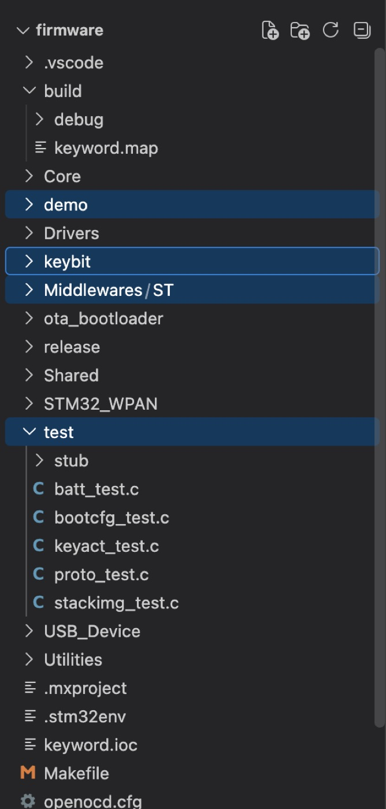

# 10/26/2026 6 PM - Keyword Flashed and Bluetooth

_Time spent: 5h_

So it turns out the STLINK V3SET was the problem the whole time (it didnt work on Ember either), so I got out an old STLINK V2 and it connected right away lol

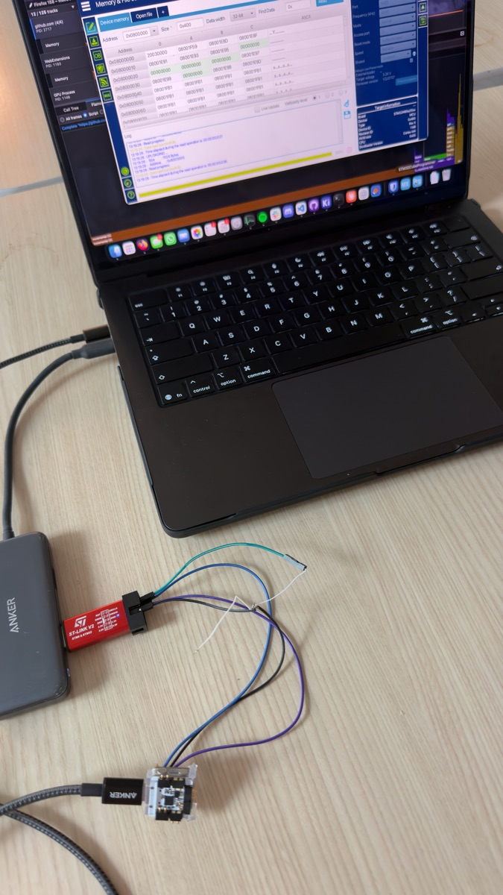

The chip was fine and already booting from flash with no read protection, so I installed the bluetooth stack (1.24.0) and flashed the OTA bootloader with the app. At first nothing ran because I only flashed the app, which lives at 0x08007000 behind the bootloader, so I had to flash the full image at 0x08000000. Then it showed up as "Keyword" in bluetooth with the green LED!! I flashed the second keyword the same way.

Then I tried updating it over bluetooth from the app and it failed because 131 packets in a row went missing on mac, so now it waits 20ms between packets and OTA works. I also added a DFU command so I can get into the USB bootloader from software since BOOT0 isnt connected to anything. The battery also says 87% with no battery plugged in because the charger keeps the empty battery pin at the charge voltage lol

The dock still couldnt see a keybit though, every read came back as all 1s so the keybit was never pulling the line low. I found a blog post where someone reverse engineered the CH32V003 debug protocol and changed the reset pulse to 2ms but it still didnt answer.

I was also worried about what happens when you put a keybit on rotated. It probably wont kill the CH32 right away but it pushes something like 30-50mA through the clamp diode on SCL (rated for 4mA) and jams the whole bus, so now the keybit wont touch a side that looks reversed and the keyword stops polling and blinks red if SDA gets stuck low.

# 10/25/2026 11 PM - SWIO, Bluetooth and Not Being Able to Flash

_Time spent: 6h_

Now that it worked I wanted the keyword to be able to flash the keybits by itself. The keyword has 3 studs on top (3.3V, SWIO, GND) that line up with the pads on the bottom of a keybit, so a keybit sitting on top gets powered and its SWIO pin lands on PB5. So I wrote a driver that bit bangs WCH's one wire debug protocol on PB5 (a short low pulse is a 1 and a long one is a 0) and a keybit firmware that bit bangs I2C on all 4 sides, and the keybit image gets embedded in the keyword firmware so it can flash any keybit put on top.

For addressing I was originally gonna have every key pick a random I2C address and check if its taken, but instead the keyword reads each CH32's unique 96 bit ID and hands it an address, and the keybit says which of its sides got addressed so the keyword knows if its on the left, right or top. Keybits that arent touching the keyword pass their presses inward through the other keybits. I also changed the keybit to keybit links to a custom protocol where a keybit with a key press rings a doorbell on the data line and then the data gets sent push pull like half duplex SPI, so it doesnt have to wait for the next poll.

I also added the bluetooth stack and a BLE keyboard to the keyword and started a desktop app that connects over USB or bluetooth, shows which side keys are on and lets me map any key to any key, shortcut, macro or media key with profiles.

Then I spent most of the night trying to flash the keyword over SWD and it would not connect. I had the wires on the wrong header of the STLINK at first, then soldered wires on, swapped DIO and CLK, soldered NRST, held BOOT0 high, tried an Atmel-ICE, and even thought SWCLK was shorted to ground but that was just my multimeter probe touching the ground pad. I also tried going through USB DFU instead and the FUS step changed the option bytes, so now it doesnt go into DFU from the BOOT0 pin anymore aaaa

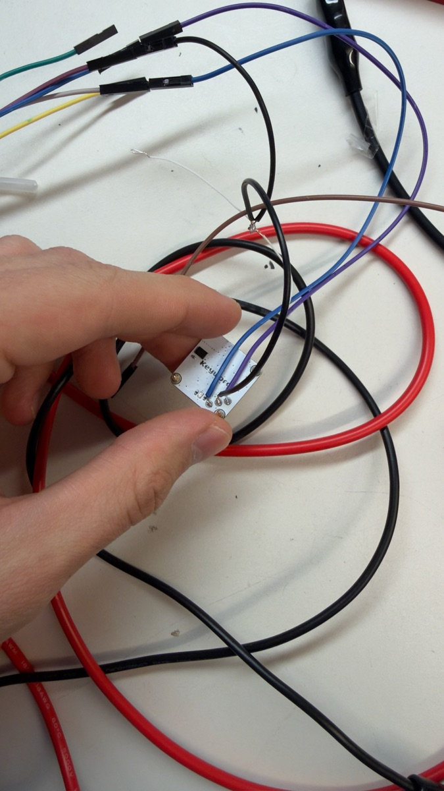

I also looked at batteries, only a 10-15mAh one fits inside the keyword, but if it sits on top theres room for an 80-130mAh one.

# 10/24/2026 9 PM - It Finally Works!!

_Time spent: 4h_

So the press fit coupon came out and none of the 7 pockets were actually press fit, the magnets just dropped into all of them so the form 4 prints them a bit oversize and I'm sticking with glue. In the end I went with the normal J7 for the keybit (8 4mm x 3mm magnets sticking out 0.75mm) and the J7.1b for the keyword which uses 2 of the 4mm x 1mm magnets on collars on every side, since that one actually worked.

Then I cleaned up onshape, moved everything back into the original keybit, keyword and keybytes docs, trashed the old 4x2 magnet docs and updated the main assembly with the 1.5mm gap between cases. All the joint tests are in [`cad/tests`](cad/tests) and the final cases are in [`production/CAD`](production/CAD), all as STEP files now.

I also changed the keyword to white solder mask with black silkscreen on both sides in kicad.

And then I put it all together and it finally works!!! Here is a picture of it

and here is the demo

[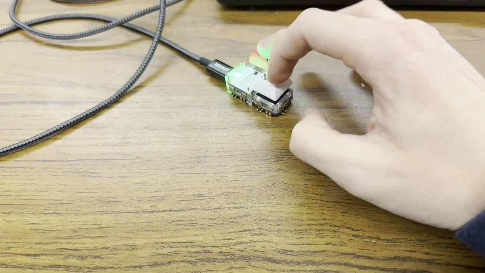](assets/demo.mp4)

[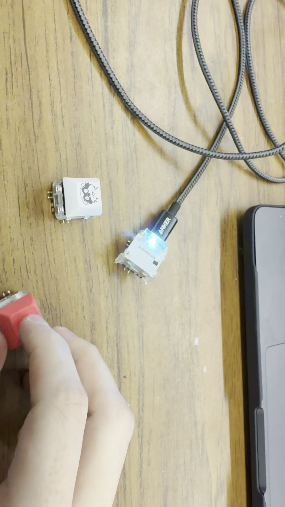](assets/journal/keybit_keyword_table.mp4)

Later that night I also posted it on r/MechanicalKeyboards

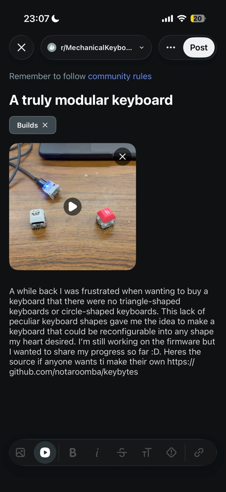

# 10/23/2026 10 PM - Gluing Magnets and Picking a Joint

_Time spent: 5h_

So I started gluing the magnets in with gorilla super glue gel (from the inside so it doesnt get on the faces) and when I put two J7 keybits together they tilted up a little. I thought I had to sand it but it turned out that glue had gotten onto the outside face of some magnets so they werent flat, after scraping it off with a razor the tilt went away. Btw acetone doesnt hurt the magnets but it does wreck the resin so dont get it on the case.

[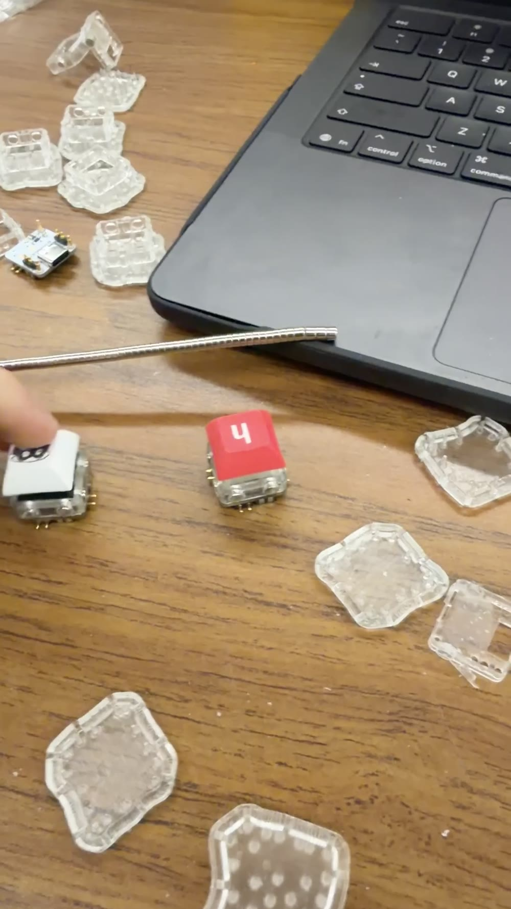](assets/journal/j7_cases_magnets.mp4)

J7 was the one I liked the most so I made it the main keybit case.

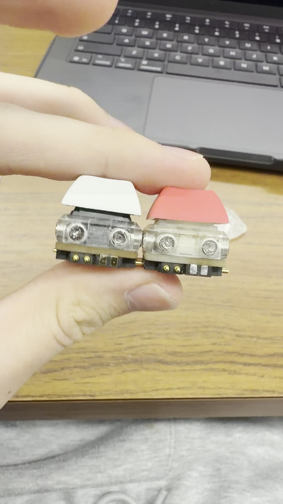

The magnets kept deflecting when I pushed them in against the keyswitch so I also designed a jig that drops in where the switch goes so they all stop at exactly 0.75mm.

For the keyword the plain pocket J7 tray was too tight for the 4x2 magnets (probably resin curing tolerance) but the collar one worked. I also realized that I need at least 2 magnets per side on the keyword like on the keybit, and since the collars stick out, a 4x1 magnet never reaches into the tray so it doesnt hit the side contacts or the inductors anymore. That made the J7.1 and J7.1b keyword trays and also a press fit coupon to see if I could skip the glue completely.

I also priced out a full sized keyboard (2 keywords and like 110 keybits) and its around $900 assembled, almost half of that being the pogo pins lol, so if I ever make a full one ill buy them seperately and solder them myself.

# 10/21/2026 10 PM - Pogo Pin Force

_Time spent: 3h_

So after the first magnet cases I noticed the magnets werent strong enough to hold the modules together against the pogo pins. I also tried putting the magnets into the pockets and sometimes they just wouldnt stick and would fall out.

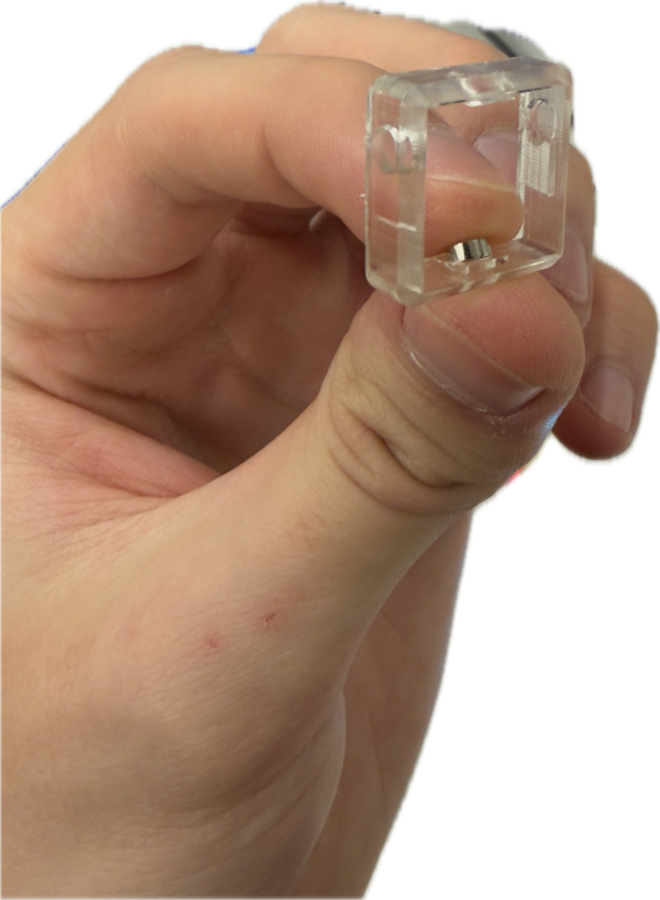

I spent some time looking on digikey for single right angle pogo pins with a low enough spring force that a 4mm x 1mm N52 magnet could hold it. The closest thing was the Mill-Max 0967 horizontal SMT pins with the low force springs, but they need a different footprint so I would have to redo the boards, so I decided to make the magnets stronger instead.

# 10/20/2026 9 PM - Tinkering With Designs and LED Blink

_Time spent: 8h_

So I have been tinkering with the designs and stuff the past 2 days, mostly the keyword case in onshape. I made a bigger version of the case with holes for the magnets and split it up into an inner part and left and right 
side pieces. 

**This was the result of many iterations that I had to spend resin printing, curing, sanding / polishing, and then tinkering with the design and making tons of modifications** 

this is v12 of the case and its the most overengineered thing ive done, I also got n55 magnets from some sketchy seller so hopefully they hold

then I put the pcb in to check that the pogo pins and usb line up with everything and yea

I also did a section view of the whole thing to check nothing was hitting inside, its currently printing so hopefully it works

I also got the first firmware on the keyword, its just a blink that cycles the RGB status LED through red, yellow, green, cyan, blue, magenta, white and off every 500ms. The only downside is that i gotta use the swd to flash it bc i changed the boot options aaaaaa

# 10/16-18/2026 5 PM - Resin Printing and Flashing

_Time spent: 14h_

So the boards came! and I learned how to resin print at the makerspace, you print it on the formlabs printer, then wash it in the 2 IPA washes, let it dry and then cure it

and I got a bunch of clear prints out of it, v1 had some problems so I still gotta clean up the resin print stuff

I also got it to flash! It connects to STM32CubeProgrammer over USB DFU even with the usb c going through the pogo pins and yea

# 10/2/2026 1 PM - Fixing Board Errors

_Time spent: 5h_

So before ordering I went through both boards again and ran DRC and ERC on everything and found a bunch of stuff that would have been bad

the biggest one was on the keybit, one of the pogo header GND pads wasnt connected to anything, the via was there but the track to it never got drawn so that side would have had no ground. Also the SDA3 trace was basically touching the 3.3V pad on one of the pullups (0.02mm lol) so i moved the resistor and rerouted that and yea

on the keyword a bunch of the resistors all had the same lcsc number which was a 150 ohm resistor with 0 stock so jlc would have put the wrong values on the charger so i cleared those, and the pads that the pogo pins land on were in the bom as pogo pins so I set them to dnp

I also fixed all the library and 3d model paths since they were hardcoded to my windows pc and didnt work on the mac, now they are relative to the project. Then I added the jlcpcb order and shipping to the bom

# 6/18/2026 8 PM - Finish CAD

_Time spent: 8h_

So i did a thing with clay and finished the case andx yea, this took a long time as I had a few revisions and yea ts is finished, i will blender render soon as im macondoing and just wanna shoip this so it arrives druring fallout

# 4/10/2026 3 AM - More Cad and finished Keybit Case

_Time spent: 7h_

So after messing around with a few designs in onshape, I got a better Keycap design

there are internal holes for the magnets and the thing latches on to the key switches side latches as shown here

i then printed it out and did a thing and got this

and yea thats basically it, Ill plan on continuing the cad for the main pcb and make it cleaner

# 4/8/2026 12 AM - CAD + Case

_Time spent: 7h_

Idk how to cad but I tried to do it and ended with soemthing like this:

which got printed and it kinda works but the corners are too small and yea

I printed a few out and showed them to clay and he liked them and yea, altho its thin I plan on making the walls thicker and yea, aside from that I think its pretty much done

# 4/6/2026 3 AM - Flash and LED and Touchups

_Time spent: 7h_

So I kinda want to be able to program the CH300v chips from the main board so I needed to add in some pogo pins and then I would also need flash to store the code so I added that in and updated the STM32 MX for that

Then after that I finished routing up everything and also replaced the old LED with a RGB one.

Then I updated the schematics to look better and yea

# 4/5/2026 7 PM - Routing

_Time spent: 7h_

So I locked in for a day and finished up the routing for both PCB's. I also had to add in some I2C pullup resistors and had fun with laying them out on both sides and yea

I also did the same for the keybit and ended up with this

it took me a while as I forgot that I had to add in pullup resistors and then had to move things around to add space for them

# 4/5/2026 12 AM - Keyword and Routing

_Time spent: 7h_

So I had a bunch of back and forth between the 2 different STM32 chips, I oringlaly planned on having eherythign on one boar dbut with bluetooht then that would be way complicated so I decided to go on St's website to try and find any stm32s that would support bluetooth and I found a small one bue that meant using a usb to hid converter but the smallest one I could find would take up half the board so I decided to split the boards, and in doing so I rediecided that if I was going to have more area, I might as well have a bigger stm32 chip and just add more stuff to it so I did that and ended up with this:

I was still placing the components so I decided to do that some more and got this

# 3/27/2026 2 AM - Ideation and Schematic

_Time spent: 9h_

So basically Ihad always wanted to make a keyboard but I didnt want to be locked into just one design so I wanna make it so that I can rearrange it at any time.

Yea...

I searched online and couldnt find it anywhere so I decided to make it myself.

I decided on using a cheap risc-v processor and i2c to communicate between the keys and then have a central MCU block that has bluetooth and battery support so yea.

I started on the keybit design (ha ha) and got this:

I then also started on the other design for the keyword

