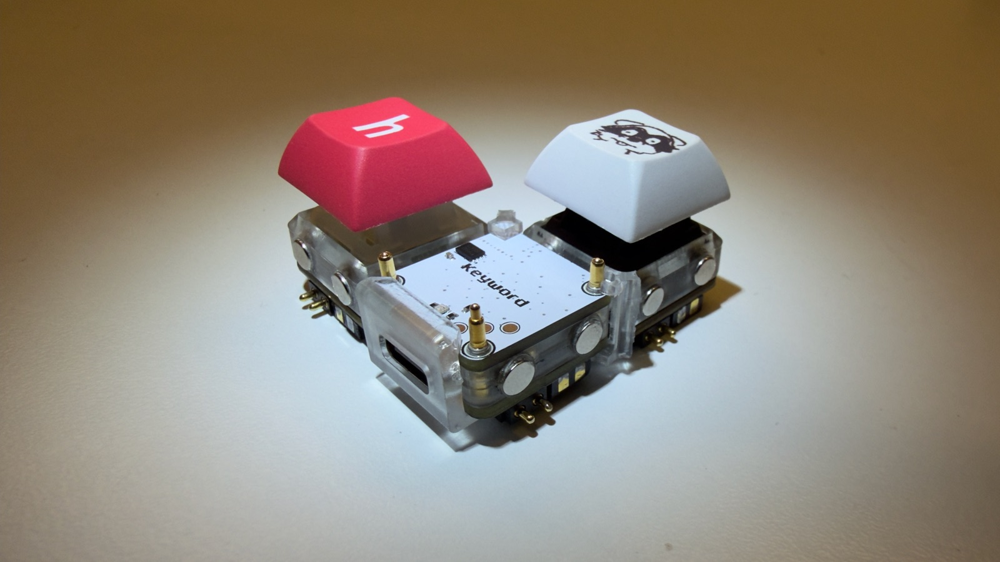
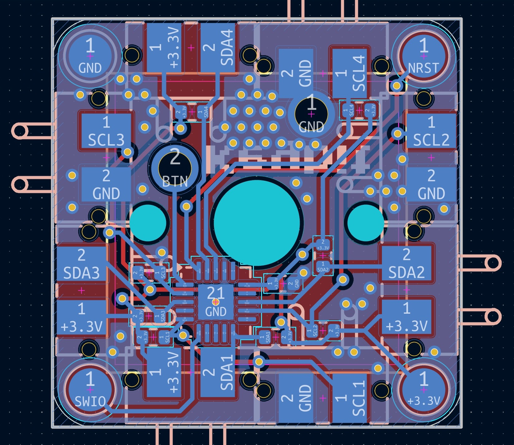
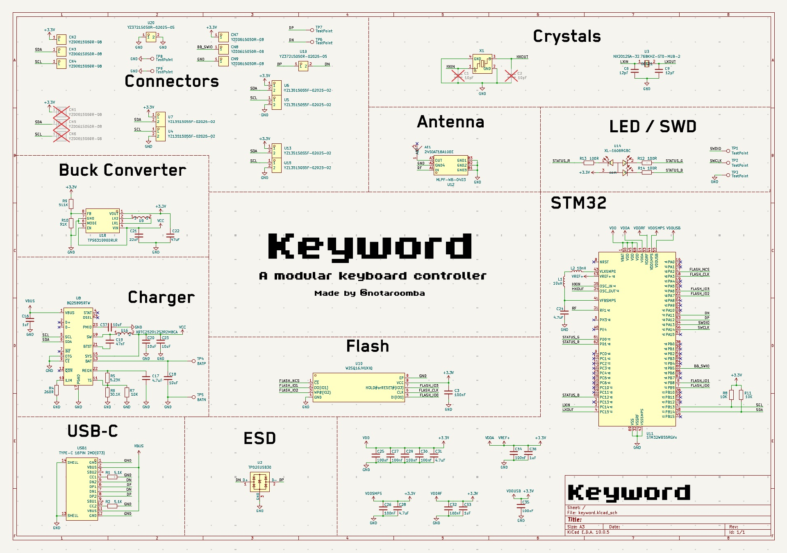
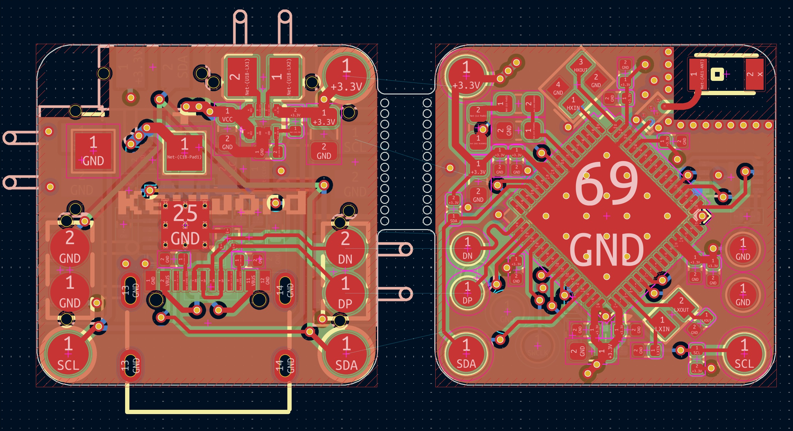
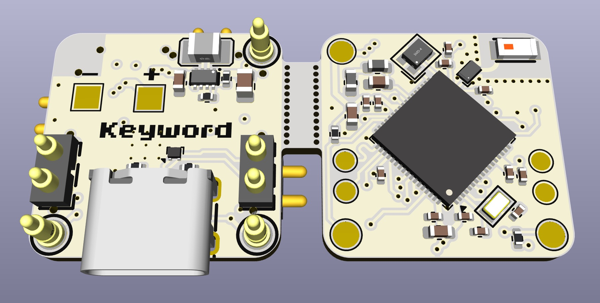
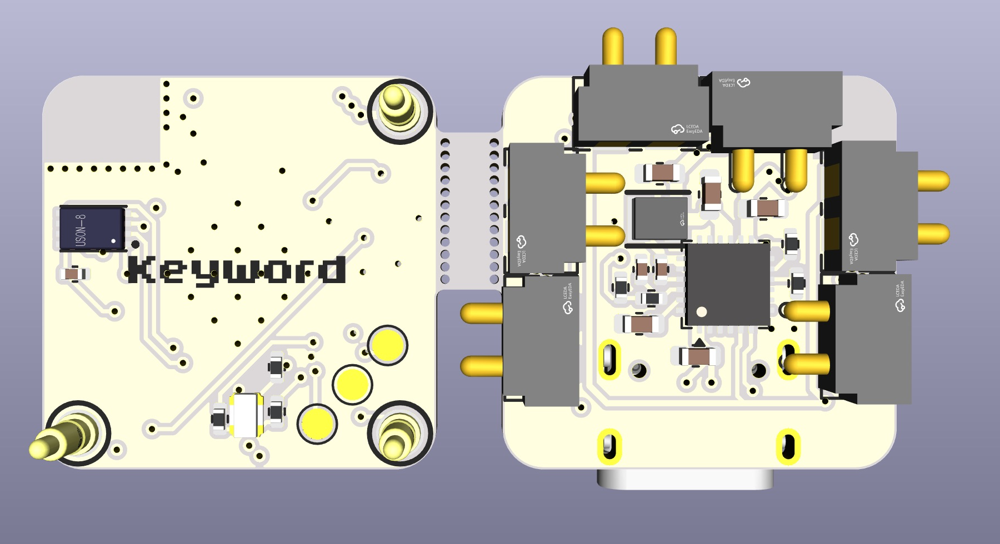
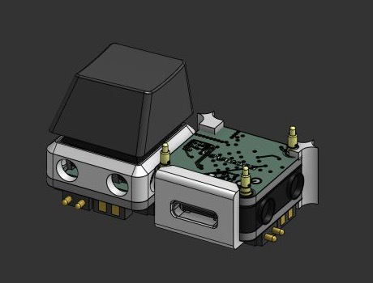

<h1 align="center">
   
  
   
</h1>

<h4 align="center">
A truly modular keyboard with rearrangeable keys, magnetic cases and Bluetooth!
</h4>

  <a href="#key-features">Key Features</a> •
  <a href="#video-demo">Video Demo</a> •
  <a href="#connecting-keybits">Connecting Keybits</a> •
  <a href="#pcb">PCB</a> •
  <a href="#case">Case</a> •
  <a href="#credits">Credits</a> •
  <a href="#license">License</a>

## Video Demo

https://github.com/user-attachments/assets/19bec26d-6e01-4ee0-906e-7e69bace2f9c

Typing over USB:

https://github.com/user-attachments/assets/b6abd347-b68b-40f1-8e2d-c50744b8104e

## Key Features

- **Rearrangeable layout** where every key is its own 1u PCB
- **CH32V003** RISC-V microcontroller on every key
- **STM32WB55RGV6** main board with Bluetooth and USB
- **Pogo pins on all 4 sides** of every key for power and I2C
- **Magnetic cases** to hold the modules together
- **Key programming** from the main board over pogo pins
- **2MB QSPI flash** (W25Q16JV) to store the key firmware
- **Battery charging** with the BQ25895 and solder pads for a 1S LiPo
- **Buck-Boost converter** (TPS631000)
- **RGB status LED**
- **USB-C** with ESD protection
- **Ceramic Bluetooth antenna**

## Connecting Keybits

Going around a keybit, the pogo pins on the N and W sides are 3.3V, SDA, GND, SCL and on the E and S sides they are SCL, GND, SDA, 3.3V. So two keybits only work together when an N or W side touches an E or S side, which gives every joint two ways a keybit can be turned and still work: the usual way, or a quarter turn so the other matching side faces its neighbour. The left and top of the keyword take an E or S side and the right takes an N or W side.

If every keybit is the same way round any shape works, like a square with the keyword in one corner. A keybit turned the wrong way gets 3.3V on its SCL and GND on its SDA, so it gets no power and nothing behind it shows up until it's turned.

**Status LED:**

- **White** idle
- **White fast blinks** a keybit joined, touching the keyword or further out
- **Blue** flashing the keybit on the programming pins
- **Green blinks then green** that keybit is flashed or already up to date
- **Solid red** flashing it gave up
- **Red blinking** a keybit on the keyword is turned the wrong way
- **Red double blink** a keybit somewhere has a neighbour turned the wrong way

**Updating keybits:** the keyword carries the keybit firmware. After updating the keyword, put every keybit on the programming pins once and wait for green. Keybits on different firmware versions don't talk to each other, so do all of them.

## PCB

Designed in KiCad! There are two boards, the Keybit and the Keyword, and both are 1u (19.05mm x 19.05mm).

### Keybit

A single key with a Cherry MX switch and a CH32V003. Every side has pogo pins for 3.3V, GND and I2C so it can connect to the keyword or to other keybits, and the pads on the corners are for programming.

**Schematic:**

**Layout:**

### Keyword

The main board that the keybits connect to. It is split into two PCBs that stack on top of each other. The top one has the STM32WB55RGV6, the antenna and the flash, and the bottom one has the USB-C, the charger and the buck-boost converter. The 3 pogo pins on the top are for programming the keybits.

**Schematic:**

**Layout:**

**3D View:**

## Case

Custom designed cases in [Onshape](https://cad.onshape.com/documents/16fd731b2222007142e5340e/w/1583a55f05f5e1a2f8aaf622/e/787b8ffe055f15084c3845af), the STEP files are in the [`cad`](cad) folder.

## Credits

This project uses:

- [KiCad](https://www.kicad.org/)
- [OnShape](https://www.onshape.com/) for case design
- [Blender](https://www.blender.org/) for 3D renders
- [STM32CubeMX](https://www.st.com/en/development-tools/stm32cubemx.html)
- [Hack Club Forge](https://forge.hackclub.com/)
- [JLCPCB](https://jlcpcb.com/) for PCB fabrication and assembly

## You may also like...

- [Ember](https://github.com/NotARoomba/ember) - A USB-C powered reflow hotplate with Bluetooth
- [Cyberboard](https://github.com/NotARoomba/Cyberboard) - A Raspberry Pi Pico-sized STM32 development board with Bluetooth
- [Trace](https://github.com/NotARoomba/Trace) - A comprehensive PCB ruler with reference footprints
- [Linea](https://github.com/NotARoomba/Linea) - An EMR tablet

## License

MIT

---

> [notaroomba.dev](https://notaroomba.dev) &nbsp;&middot;&nbsp;
> GitHub [@NotARoomba](https://github.com/NotARoomba) &nbsp;&middot;&nbsp;
