<h1 align="center">
   
  <a href="https://notaroomba.dev">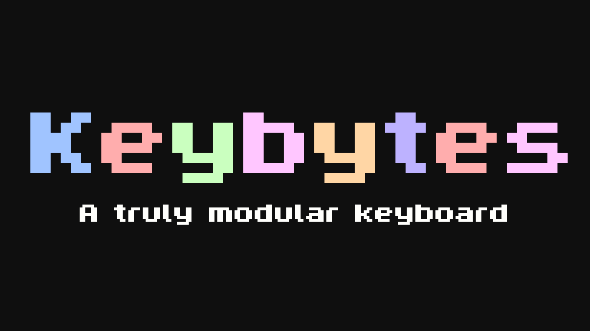</a>
   
</h1>

<h4 align="center">
A truly modular keyboard with rearrangeable keys, magnetic cases and Bluetooth!
</h4>

  <a href="#key-features">Key Features</a> •
  <a href="#video-demo">Video Demo</a> •
  <a href="#connecting-keybits">Connecting Keybits</a> •
  <a href="#pcb">PCB</a> •
  <a href="#credits">Credits</a> •
  <a href="#license">License</a>

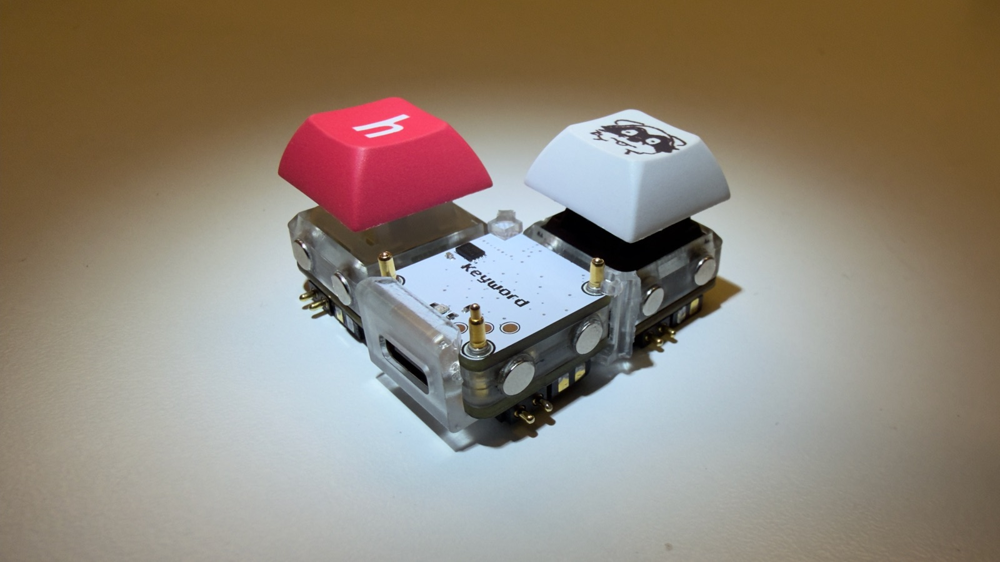

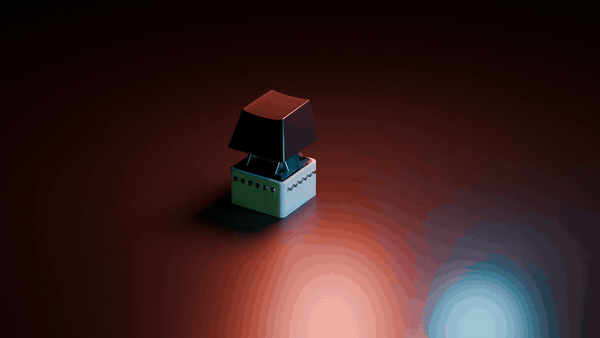

*(v2 preview)*

## Video Demo

https://github.com/user-attachments/assets/19bec26d-6e01-4ee0-906e-7e69bace2f9c

Typing over USB:

https://github.com/user-attachments/assets/b6abd347-b68b-40f1-8e2d-c50744b8104e

## Key Features

- **Rearrangeable layout** where every key is its own 1u PCB
- **CH592F** RISC-V microcontroller with BLE and USB on every key
- **Cross shaped 2 layer flex PCB** that folds up into the case, with FR4 stiffeners
- **Magnet contacts** on all 4 sides, 6 per side (1x2mm N52) on a 2.38mm grid
- **Any rotation** and 0/25/50/75% stagger between keys
- **Polarity independent** sides, a small FET bridge on each side sorts out VBUS and GND
- **WS2812 RGB LED** on every key
- **Mill-Max 3305** hot swap sockets
- **Hall variant** with a TMAG3001 3-axis hall sensor, so the same board can be a hall key, a knob or a joystick
- **Keyword** main board with a CH592F, BLE and USB-C
- **Battery charging** with the BQ25185 for a small LiPo
- **USB-C** with ESD protection (USBLC6)
- **Pogo pin flashing** of every Keybit from the Keyword, then OTA updates
- **Flex spacers** (1u, 0.75u and 0.5u) to pass power across gaps

## V1

V1 had a CH32V003 on every key with pogo pins on all 4 sides and an STM32WB55 Keyword split into two stacked PCBs. It lives in the [`v1`](https://github.com/notaroomba/keybytes/tree/v1) branch.

## Connecting Keybits

The side contacts are the magnets themselves. Every side has 6 contact magnets on a 2.38mm grid with the A and B nets alternating, so two keybits connect no matter which way round they are and at any 0/25/50/75% stagger. Each side has a small FET bridge that connects whichever net is higher to VBUS and the other one to GND, so polarity doesn't matter either.

**Flashing keybits:** the 4 pogo pins on top of the keyword (GND, TIO, TCK, 3V3) line up with the pads on the bottom of every keybit, so a keybit gets flashed by pressing it onto the keyword. After that it updates over OTA.

The v2 firmware for the CH592F is still in progress. The v1 status LED codes are in the [`v1`](https://github.com/notaroomba/keybytes/tree/v1) branch.

## PCB

Designed in KiCad! There are two main boards, the Keybit and the Keyword, plus passive flex spacers (1u, 0.75u and 0.5u) that pass power across gaps.

### Keybit

A single key on a cross shaped 2 layer flex PCB with a CH592F in the middle, a WS2812 RGB LED and Mill-Max 3305 hot swap sockets for the switch. The 4 flaps fold up into the case and have FR4 stiffeners, and each one has 6 contact magnets and a FET bridge for power. The pads on the bottom are for flashing it from the keyword. The hall variant has a TMAG3001 3-axis hall sensor, so the same board can be a hall key, a knob (in the encoder case) or a joystick.

**Schematic:**

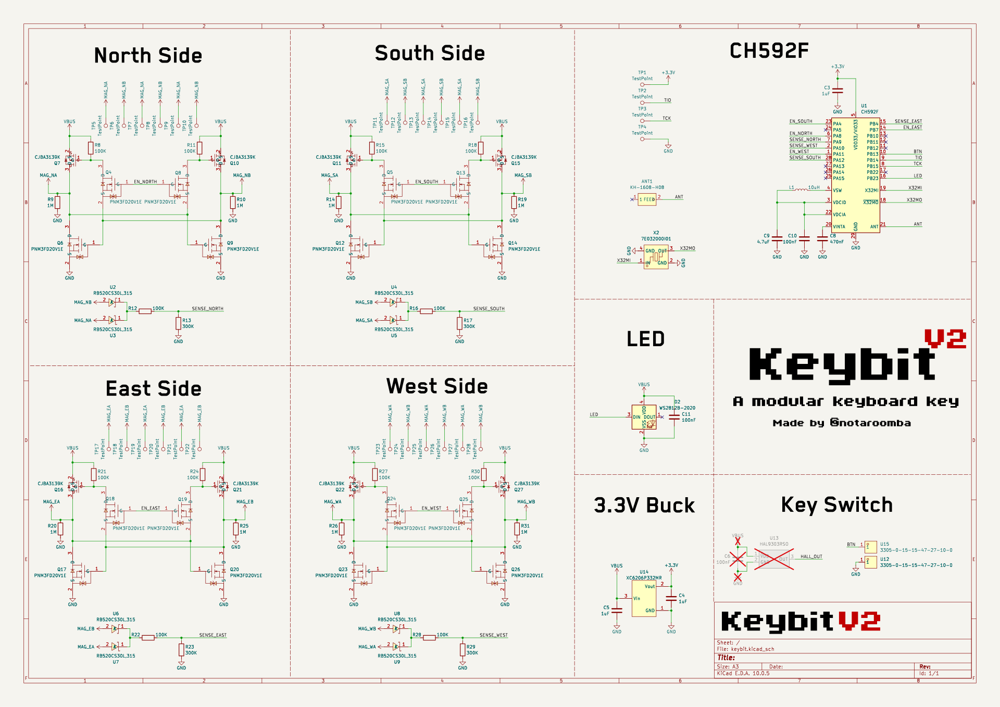

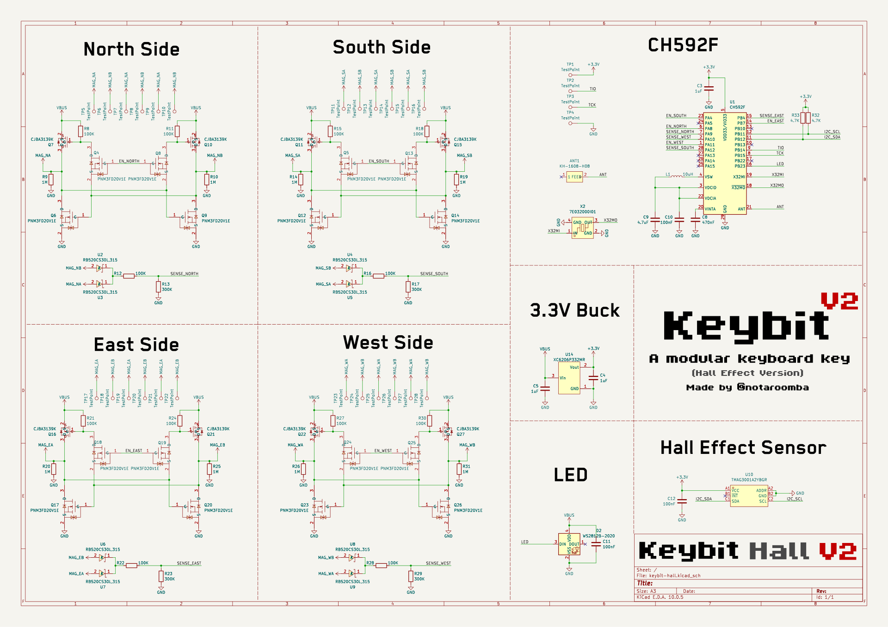

**Layout:**

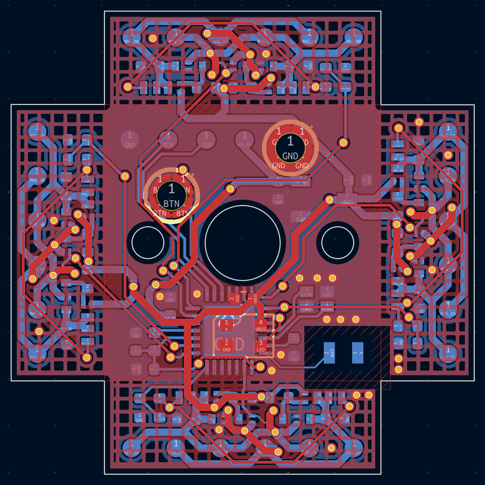

**3D View:**

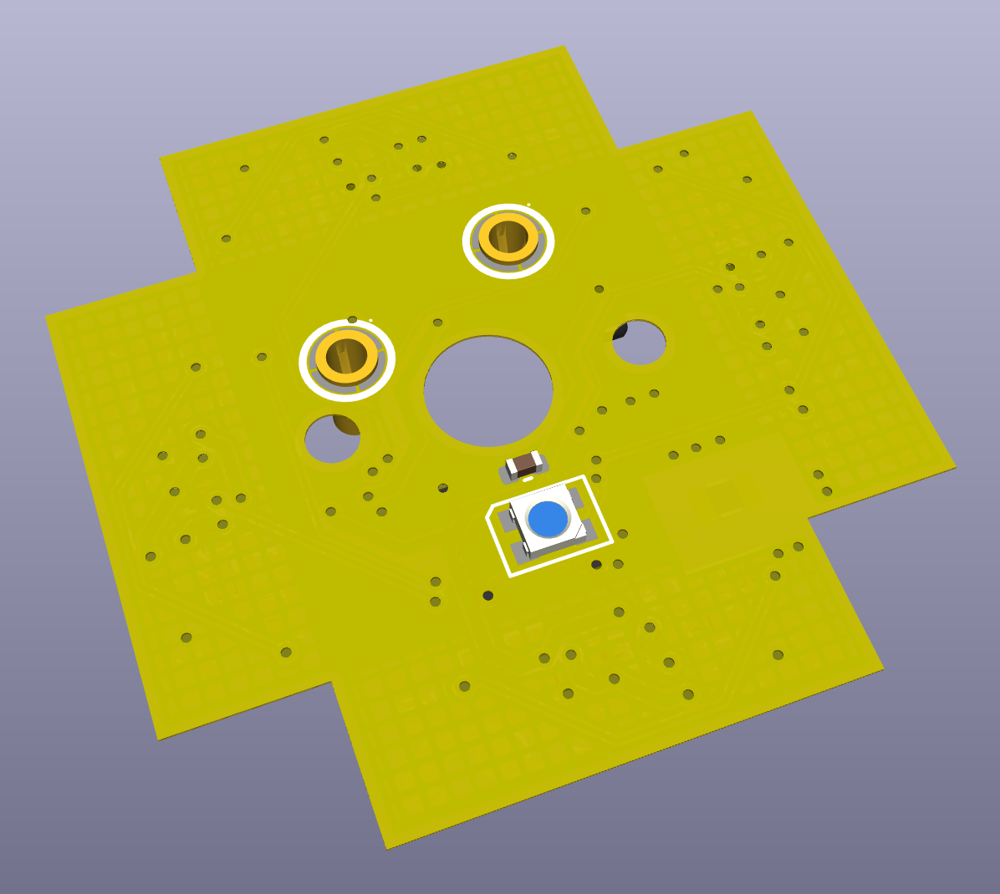
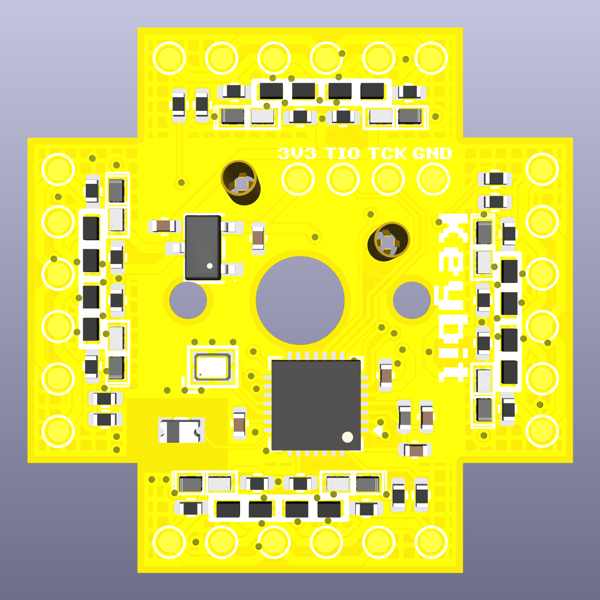

### Keyword

The main board that the keybits connect to. It is now one flex board with a CH592F for BLE and USB-C, a BQ25185 charger for a small LiPo and a USBLC6 for ESD protection. The 4 SMD pogo pins on the top (GND, TIO, TCK, 3V3) are for flashing the keybits.

**Schematic:**

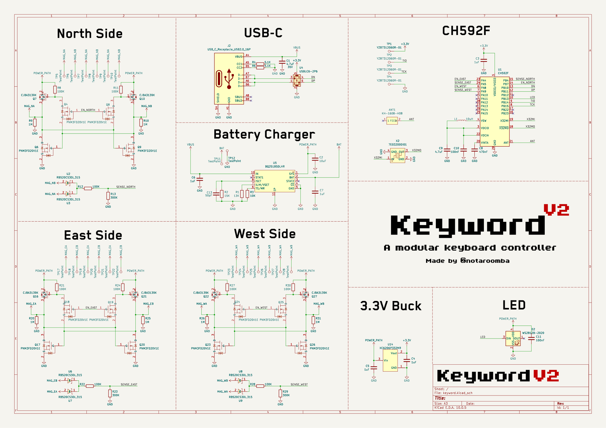

**Layout:**

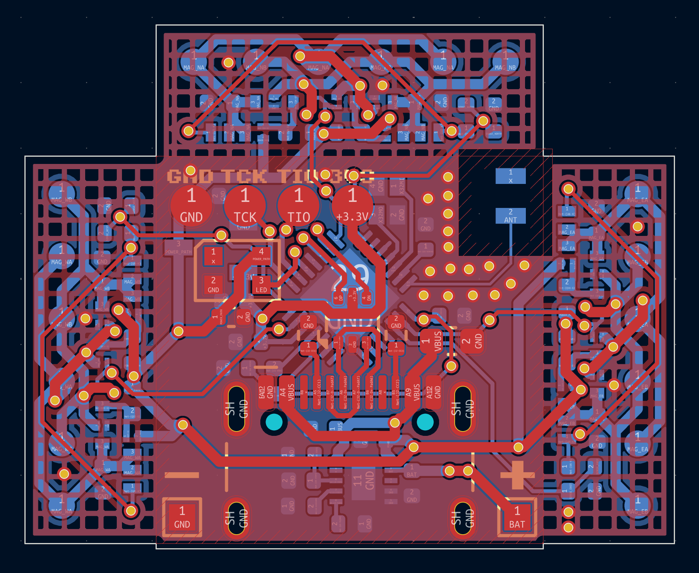

**3D View:**

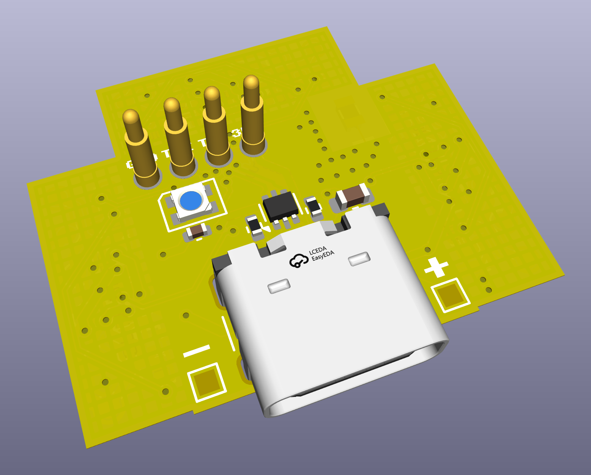
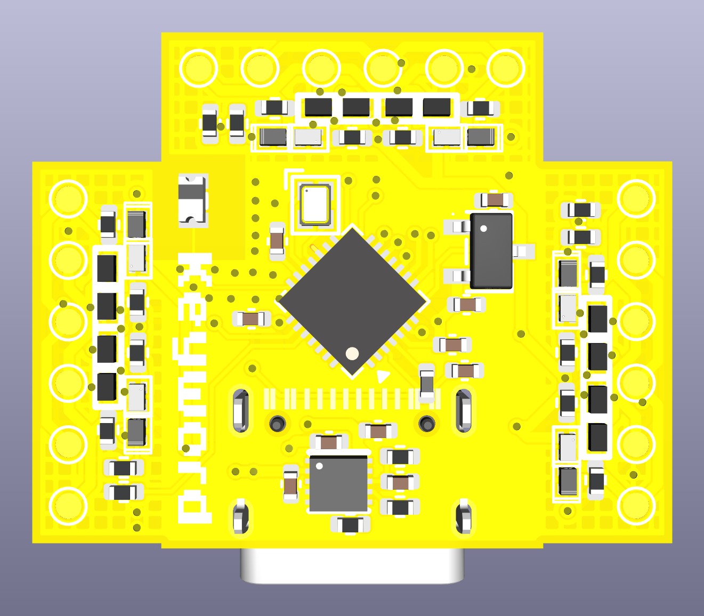

### Manufacturing

Everything is panelized for JLC flex PCBA. The files are in [`production/panels`](production/panels): `8x3-panel` is the full order, `2x3-test-panel` is a smaller test order and `spacer-panel` is the bare flex spacers.

## Credits

This project uses:

- [KiCad](https://www.kicad.org/)
- [OnShape](https://www.onshape.com/) for case design
- [Blender](https://www.blender.org/) for 3D renders
- [ch32fun](https://github.com/cnlohr/ch32fun) and the WCH SDK for the CH592F
- [Formlabs](https://formlabs.com/) for resin printing
- [Hack Club Forge](https://forge.hackclub.com/)
- [JLCPCB](https://jlcpcb.com/) for PCB fabrication and assembly
- [JLCCNC](https://jlccnc.com/) for the encoder knob

## You may also like...

- [Ember](https://github.com/NotARoomba/ember) - A USB-C powered reflow hotplate with Bluetooth
- [Cyberboard](https://github.com/NotARoomba/Cyberboard) - A Raspberry Pi Pico-sized STM32 development board with Bluetooth
- [Trace](https://github.com/NotARoomba/Trace) - A comprehensive PCB ruler with reference footprints
- [Linea](https://github.com/NotARoomba/Linea) - An EMR tablet

## License

MIT

---

> [notaroomba.dev](https://notaroomba.dev) &nbsp;&middot;&nbsp;
> GitHub [@NotARoomba](https://github.com/NotARoomba) &nbsp;&middot;&nbsp;
